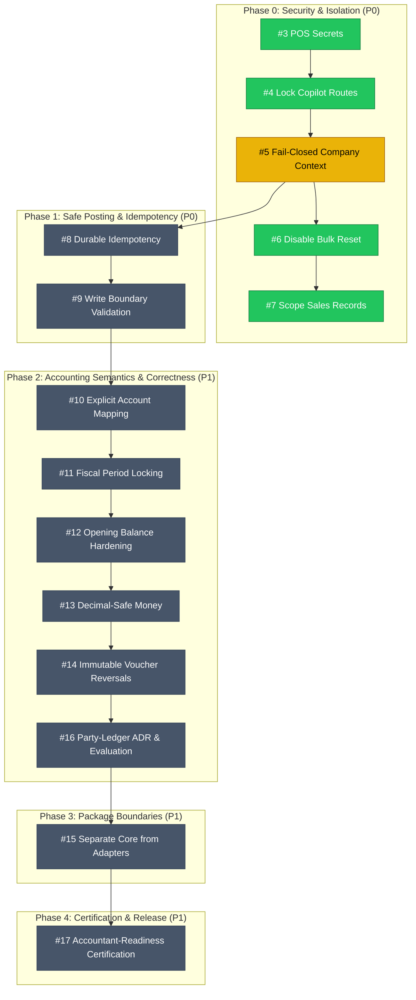

Viewed Work-Session-Oct-16-2026.md:1-84
Ran command: Check git status and remotes (`git status; git remote -v; git log -n 5 --oneline`)
Ran command: List GitHub issues (`gh issue list --limit 30`)
Viewed list_issues.json
List all issues from GitHub (github)
Ran command: Search issue references (`Get-ChildItem -Recurse -File -Path docs, .project | Select-String -Pattern "issue|#5|#8|#9|#10|#15" -List | Select-Object -ExpandProperty Path`)
Ran command: List all branches (`git branch -a`)
Ran command: Check main branch commits (`git log origin/main -n 20 --oneline`)
Ran command: Check fail-closed branch (`git log origin/codex/p0-fail-closed-company-context -n 5 --oneline`)
Ran command: Check other remote branch commits (`git log origin/codex/fix-pos-approval-authorization-tests -n 3 --oneline; git log origin/codex/fix-pos-approval-regression-tests-20261016 -n 3 --oneline; git log origin/codex/followup-pr33-authorization-test-contract -n 3 --oneline`)
Ran command: Git fetch origin (`git fetch origin --prune`)
Ran command: Search git log for fail-closed (`git log --all --grep="fail-closed" --oneline`)
Ran command: Search git log for issue (`git log --all --grep="issue" --oneline`)
Viewed production-readiness-audit.md:1-98
Viewed ALAMIA_ACCOUNTS_CI.md:1-22
Ran command: List workflow files (`Get-ChildItem -Path .github/workflows`)
Ran command: Fetch issues from public GitHub API (`Invoke-RestMethod -Uri "https://api.github.com/repos/AlamiaSoft/AlamiaAccounts/issues?state=all&per_page=100" -Headers @{"User-Agent"="PowerShell"} | Select-Object number, title, state, html_url`)
Ran command: Check if repo is private (`curl -s -I "https://api.github.com/repos/AlamiaSoft/AlamiaAccounts"`)
Ran command: Check GitHub API response headers (`curl.exe -s -I "https://api.github.com/repos/AlamiaSoft/AlamiaAccounts"`)
Ran command: Fetch issues list via curl (`curl.exe -s "https://api.github.com/repos/AlamiaSoft/AlamiaAccounts/issues?state=all" | Out-File -FilePath temp_issues.json -Encoding utf8; (Get-Content temp_issues.json | ConvertFrom-Json) | Select-Object number, title, state, html_url | Format-Table -AutoSize`)
Ran command: Remove temp_issues.json (`Remove-Item -Force temp_issues.json`)
Ran command: Fetch page 2 issues (`curl.exe -s "https://api.github.com/repos/AlamiaSoft/AlamiaAccounts/issues?state=all&page=2" | Out-File -FilePath temp_issues2.json -Encoding utf8; (Get-Content temp_issues2.json | ConvertFrom-Json) | Select-Object number, title, state, html_url | Format-Table -AutoSize; Remove-Item -Force temp_issues2.json`)
Ran command: Fetch open PRs (`curl.exe -s "https://api.github.com/repos/AlamiaSoft/AlamiaAccounts/pulls?state=open" | Out-File -FilePath temp_pulls.json -Encoding utf8; (Get-Content temp_pulls.json | ConvertFrom-Json) | Select-Object number, title, state, html_url, head | Format-List; Remove-Item -Force temp_pulls.json`)
Ran command: Fetch issue #18 (`curl.exe -s "https://api.github.com/repos/AlamiaSoft/AlamiaAccounts/issues/18" | Out-File -FilePath temp_issue18.json -Encoding utf8; (Get-Content temp_issue18.json | ConvertFrom-Json) | Select-Object number, title, state, body | Format-List; Remove-Item -Force temp_issue18.json`)
Ran command: Fetch issue #5 (`curl.exe -s "https://api.github.com/repos/AlamiaSoft/AlamiaAccounts/issues/5" | Out-File -FilePath temp_issue5.json -Encoding utf8; (Get-Content temp_issue5.json | ConvertFrom-Json) | Select-Object number, title, state, body | Format-List; Remove-Item -Force temp_issue5.json`)
Ran command: Check p0-fail-closed branch commits (`git log origin/codex/p0-fail-closed-company-context -n 10 --stat`)
Ran command: Check git push credentials (`git push --dry-run origin HEAD`)
Ran command: Search .project/tasks (`Get-ChildItem -Path .project/tasks | Select-String -Pattern "fallback|DomainContext|tenant|fail-closed" -List | Select-Object -ExpandProperty Path`)
Viewed T-002.md:1-35
Ran command: Git merge-base (`git merge-base main refactor/standalone-package-encapsulation`)
Ran command: List commits in origin/main ahead of refactor (`git log 119284bc2045ea921fdb6183b6a443f32a9cceca..origin/main --oneline`)
Ran command: List commits in refactor ahead of origin/main (`git log origin/main..refactor/standalone-package-encapsulation --oneline`)
Ran command: Fetch GitHub Actions CI status (`curl.exe -s "https://api.github.com/repos/AlamiaSoft/AlamiaAccounts/actions/runs?per_page=5" | Out-File -FilePath temp_actions.json -Encoding utf8; (Get-Content temp_actions.json | ConvertFrom-Json).workflow_runs | Select-Object name, head_branch, head_sha, status, conclusion, html_url | Format-Table -AutoSize; Remove-Item -Force temp_actions.json`)
Ran command: Fetch comments on issue 18 (`curl.exe -s "https://api.github.com/repos/AlamiaSoft/AlamiaAccounts/issues/18/comments" | Out-File -FilePath temp_c18.json -Encoding utf8; (Get-Content temp_c18.json | ConvertFrom-Json) | Select-Object user, created_at, body | Format-List; Remove-Item -Force temp_c18.json`)

# Current State & Execution Queue Audit

In accordance with [docs/Work-Session-Oct-16-2026.md](file:///e:/Alamia/AlamiaAccounts/docs/Work-Session-Oct-16-2026.md) and authoritative GitHub Orchestration Issue [#18](https://github.com/AlamiaSoft/AlamiaAccounts/issues/18), the current repository state, issue feed, PR status, and execution dependencies have been verified against `origin`.

---

## 1. Repository & Git State Verification

| Attribute | Verified Status |
| :--- | :--- |
| **Repository Root** | `e:\Alamia\AlamiaAccounts` |
| **Git Remote** | `origin` &rarr; `https://github.com/AlamiaSoft/AlamiaAccounts.git` |
| **Current Branch** | `refactor/standalone-package-encapsulation` |
| **Working Tree** | Clean (untracked `docs/Work-Session-Oct-16-2026.md`) |
| **Latest `main` Commit** | [`322d49d`](https://github.com/AlamiaSoft/AlamiaAccounts/commit/322d49d4975646fe9d12e906ef3ee099a3d21887) (*Merge pull request #30 from AlamiaSoft/codex/p0-pos-credential-hardening*) |
| **Latest CI Run on `main`** | **SUCCESS / GREEN** (Workflow: `Alamia Accounts CI`, Run ID: [`322d49d`](https://github.com/AlamiaSoft/AlamiaAccounts/actions/runs/322d49d4975646fe9d12e906ef3ee099a3d21887)) |

---

## 2. Issues & Pull Request Feed Audit

### Resolved / Merged PRs
- **[#30](https://github.com/AlamiaSoft/AlamiaAccounts/pull/30)**: *[P0 Security] Remove embedded POS credentials and fail closed* (**MERGED** &mdash; resolves Issue [#3](https://github.com/AlamiaSoft/AlamiaAccounts/issues/3))
- **[#31](https://github.com/AlamiaSoft/AlamiaAccounts/pull/31)**: *[P0 Security] Disable public Copilot execution and diagnostics routes* (**MERGED** &mdash; resolves Issue [#4](https://github.com/AlamiaSoft/AlamiaAccounts/issues/4))
- **[#32](https://github.com/AlamiaSoft/AlamiaAccounts/pull/32)**: *[P0 Security] Remove destructive bulk ledger reset endpoint* (**MERGED** &mdash; resolves Issue [#6](https://github.com/AlamiaSoft/AlamiaAccounts/issues/6))
- **[#33](https://github.com/AlamiaSoft/AlamiaAccounts/pull/33)**: *[P0 Security] Scope POS sale details, receipts and approval by company* (**MERGED** &mdash; resolves Issue [#7](https://github.com/AlamiaSoft/AlamiaAccounts/issues/7))
- **[#34](https://github.com/AlamiaSoft/AlamiaAccounts/pull/34)**: *[P0 Security] Patch Symfony HttpFoundation CVE-2026-108082* (**MERGED**)

### Current Open Pull Requests
- **0 open PRs** across the repository.

---

## 3. Verified Execution Queue & Dependency Graph

Per Issue [#18](https://github.com/AlamiaSoft/AlamiaAccounts/issues/18) and `docs/Work-Session-Oct-16-2026.md`:

---

## 4. Next Immediate Priority: Issue [#5](https://github.com/AlamiaSoft/AlamiaAccounts/issues/5)

**Title:** `[P0][Accounting] Replace ambient tenant fallback with fail-closed company context`  
**Prerequisites:** All satisfied (#3 and #4 are merged; CI is green on `main`).  
**Blocks:** [#8](https://github.com/AlamiaSoft/AlamiaAccounts/issues/8) (*Posting identity and durable idempotency*).

### Scope of Work for Issue #5:
1. **Remove Ambient Fallback**: Audit and eliminate silent fallback to the first domain (`LedgerDomain::first()`) or fallback to `MAIN` in:
   - [`AlamiaAccounts-Backend/packages/AlamiaSoft/alamia-accounts/src/Services/DomainContext.php`](file:///e:/Alamia/AlamiaAccounts/AlamiaAccounts-Backend/packages/AlamiaSoft/alamia-accounts/src/Services/DomainContext.php)
   - [`AlamiaAccounts-Backend/packages/AlamiaSoft/alamia-accounts/src/Services/VoucherService.php`](file:///e:/Alamia/AlamiaAccounts/AlamiaAccounts-Backend/packages/AlamiaSoft/alamia-accounts/src/Services/VoucherService.php)
   - [`AlamiaAccounts-Backend/packages/AlamiaSoft/alamia-accounts/src/Services/OpeningBalanceService.php`](file:///e:/Alamia/AlamiaAccounts/AlamiaAccounts-Backend/packages/AlamiaSoft/alamia-accounts/src/Services/OpeningBalanceService.php)
   - [`AlamiaAccounts-Backend/packages/AlamiaSoft/alamia-accounts/src/Services/ExpenseIntegrationService.php`](file:///e:/Alamia/AlamiaAccounts/AlamiaAccounts-Backend/packages/AlamiaSoft/alamia-accounts/src/Services/ExpenseIntegrationService.php)
2. **Fail-Closed Context**: Missing, unknown, or unauthorized tenant context must reject write/read requests with HTTP `400/403/422` instead of defaulting to a global or first domain.
3. **Context Lifecycle**: Ensure context reset happens at request/job boundaries and in `finally` blocks to eliminate bleed across queue workers or long-lived PHP processes.
4. **Targeted Tests**: Add unit and regression tests asserting that requests without valid authorized company context fail closed.

---

### Ready to proceed?
I can create a clean branch tracking `origin/main` (e.g. `codex/p0-fail-closed-company-context`) and begin implementing the fail-closed company context changes and regression test suite for **Issue #5**.