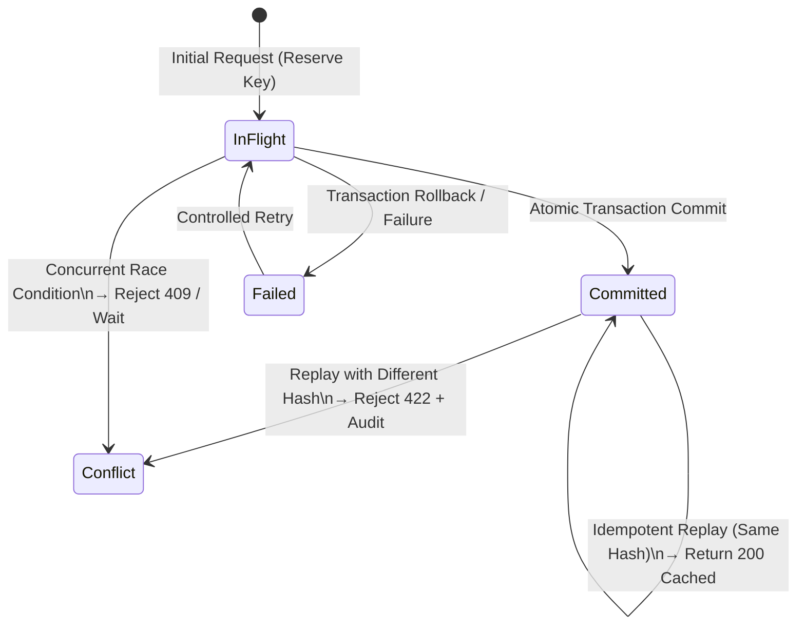

# ADR-008: Durable Posting Identity and Replay Contract

**Status**: Accepted  
**Date**: 2026-10-16  
**Context**: Issue #8, Issue #36 (Day 1 of DAG decomposition)  
**Parent Epic**: [Issue #8: Make posting identity and idempotency durable and concurrency-safe](https://github.com/AlamiaSoft/AlamiaAccounts/issues/8)  
**Task**: [Issue #36: Specify durable posting identity and replay contract](https://github.com/AlamiaSoft/AlamiaAccounts/issues/36)  

---

## 1. Executive Summary

In financial and double-entry accounting systems, ledger postings must guarantee **exactly-once execution semantics**. Network retries, timeout recoveries, and concurrent client requests must never duplicate journal entries or corrupt account balances.

Prior to this specification, deduplication relied on searching JSON strings inside `journal_entries.extra` using unindexed `LIKE` queries, or looping over retrieved records in memory before initiating database transactions. Under concurrent load, requests could race through pre-checks and create duplicate vouchers.

This Architecture Decision Record establishes a formal, reviewable contract for:
1. **Stable Posting Identity**: A canonical 5-tuple identifying every financial operation.
2. **Deterministic Payload Fingerprinting**: Cryptographic SHA-256 fingerprinting with strict key normalization and fixed-point numeric formatting.
3. **Finite State Machine & Replay Semantics**: Explicit handling of idempotent replays, payload mismatch conflicts, concurrent execution races, timeouts after commit, and rollback recovery.
4. **Database-Enforced Persistence Constraints & Atomic Boundaries**: Replacing string searches with database unique constraints across tenants.

---

## 2. Current Implementation Analysis & Gap Identification

Inspection of the existing codebase reveals four specific architectural vulnerabilities:

### 2.1 Unindexed SQL `LIKE` Scans against JSON Metadata
* **Inspected Code**: [`ExpenseIntegrationService.php`](file:///e:/Alamia/AlamiaAccounts/AlamiaAccounts-Backend/packages/AlamiaSoft/alamia-accounts/src/Services/ExpenseIntegrationService.php#L64-L72)
```php
// Existing Flow in ExpenseIntegrationService.php:
$existingEntry = DB::table('journal_entries')
    ->join('domain_journal_entries', 'journal_entries.journalEntryId', '=', 'domain_journal_entries.journalEntryId')
    ->where('domain_journal_entries.domainUuid', $domainUuid)
    ->where('journal_entries.extra', 'like', '%"reference":"' . $reference . '"%')
    ->select('journal_entries.*')
    ->first();
```
* **Defect**:
  - Full table scan on `journal_entries.extra` (JSON serialized text).
  - Subject to substring collisions (e.g. searching for reference `"EXP-1"` matches `"EXP-10"` or `"EXP-100"`).
  - Executed outside of a row-level lock or database constraint, creating a concurrency window between read and subsequent write.

### 2.2 In-Memory Voucher Looping Before Transaction
* **Inspected Code**: [`VoucherService.php`](file:///e:/Alamia/AlamiaAccounts/AlamiaAccounts-Backend/packages/AlamiaSoft/alamia-accounts/src/Services/VoucherService.php#L70-L80)
```php
// Existing Flow in VoucherService.php:
$refToCheck = trim($data['reference'] ?? $data['voucher_number'] ?? '');
if ($refToCheck !== '') {
    $existingVouchers = $this->getJournalEntries(['reference' => $refToCheck]);
    foreach ($existingVouchers as $ev) {
        if (strcasecmp($ev['reference'] ?? '', $refToCheck) === 0) {
            throw new Exception("Duplicate voucher reference '{$refToCheck}' is not allowed for this company");
        }
    }
}
```
* **Defect**:
  - Check occurs in PHP memory before `DB::transaction(...)` begins.
  - Two concurrent HTTP requests with reference `INV-2026-001` both execute the check before either commits, passing validation simultaneously and creating duplicate vouchers in the ledger.

### 2.3 Missing Database Unique Constraints on Voucher Reference and Domain Association
* **Inspected Migration**: [`2025_12_05_053448_create_domain_journal_entries_table.php`](file:///e:/Alamia/AlamiaAccounts/AlamiaAccounts-Backend/packages/AlamiaSoft/alamia-accounts/database/migrations/2025_12_05_053448_create_domain_journal_entries_table.php#L17-L43)
```php
// Existing domain_journal_entries schema:
$table->foreignUuid('domainUuid');
$table->unsignedBigInteger('journalEntryId');
$table->unique(['domainUuid', 'journalEntryId'], 'domain_entry_unique');
```
* **Defect**:
  - There is no `reference` column on `domain_journal_entries`.
  - The database does not enforce `UNIQUE(domainUuid, reference)`. Duplicate references within a company cannot be prevented at the storage layer.

### 2.4 Lack of Idempotency Response Cache & Payload Equality Validation
* **Inspected Code**: [`UnpostedIntegrationEntry.php`](file:///e:/Alamia/AlamiaAccounts/AlamiaAccounts-Backend/packages/AlamiaSoft/alamia-accounts/src/Models/UnpostedIntegrationEntry.php#L15-L35)
* **Defect**:
  - `unposted_integration_entries` only records failed requests.
  - Successful postings have no persisted idempotency record storing the original HTTP response. A replayed request must query and reconstruct responses ad-hoc.
  - Reusing an idempotency key with a mutated payload (e.g., changing amount from \$500 to \$5,000) is not detected or audited as a security violation.

---

## 3. Canonical Posting Identity Specification

Every financial mutation must have a unique, deterministically resolvable posting identity.

### 3.1 Identity 5-Tuple Structure
A stable posting identity consists of five strictly defined elements:

$$\text{PostingIdentity} = \langle \text{SourceModule}, \text{CompanyCode}, \text{SourceTransactionId}, \text{Operation}, \text{Version} \rangle$$

| Field | Type | Description | Example |
| :--- | :--- | :--- | :--- |
| `source_module` | `VARCHAR(50)` | Originating system, sub-system, or integration adapter | `pos`, `travelos`, `copilot`, `api` |
| `company_code` | `VARCHAR(50)` | Target company tenant code (normalized uppercase) | `MAIN`, `KAMAL_EXPRESS` |
| `source_transaction_id` | `VARCHAR(100)` | Originating system's unique identifier | `TKT-2026-9041`, `EXP-401` |
| `operation` | `VARCHAR(50)` | Specific financial action | `post`, `reverse`, `amend` |
| `version` | `VARCHAR(20)` | Schema or contract revision | `v1` |

### 3.2 Canonical String Representation
When serialized as an `idempotency_key`, the 5-tuple follows the canonical format:
```text
{source_module}:{company_code}:{source_transaction_id}:{operation}:{version}
```

*Example Canonical Keys*:
- `travelos:MAIN:EXP-2026-0089:post:v1`
- `pos:KAMAL_EXPRESS:TKT-991204:post:v1`
- `api:MAIN:VCH-MANUAL-0042:post:v1`

If an external caller provides an explicit HTTP `Idempotency-Key` header, the header value takes precedence as the primary lookup key, while the derived canonical 5-tuple is stored in identity columns for audit correlation.

---

## 4. Deterministic Payload Fingerprinting Specification

To detect key reuse with conflicting arguments (tampering, unintended copy-paste, or client bugs), a cryptographic SHA-256 fingerprint of the normalized request payload must be stored.

### 4.1 Normalization Algorithm
Before hashing, the payload array must undergo recursive canonicalization:

1. **Transient Field Elimination**:
   Omit all metadata fields that vary across retries or transport layers:
   `['idempotency_key', 'timestamp', 'request_time', 'current_time', 'request_id', '_token', 'created_at', 'updated_at']`.
2. **Recursive Key Sorting**:
   All associative array keys at all depths must be sorted lexicographically in ascending order (`ksort`).
3. **Numeric Format Standardization**:
   All floating-point, integer, or string monetary numbers must be formatted to 4 decimal places with a period separator and no thousands separators:
   `number_format((float)$val, 4, '.', '')`.
4. **Boolean & Null Standardization**:
   Booleans are normalized to literal `true`/`false`. Nulls remain `null`. Empty strings remain `""`.
5. **Deterministic Serialization**:
   Encode using `json_encode($normalized, JSON_UNESCAPED_SLASHES | JSON_UNESCAPED_UNICODE)`.
6. **Hashing**:
   `payload_hash = hash('sha256', $jsonString)`.

### 4.2 Mathematical Equality Contract
For two payloads $P_1$ and $P_2$:

$$\text{payload\_hash}(P_1) = \text{payload\_hash}(P_2) \iff \text{SemanticFinancialEquality}(P_1, P_2)$$

If any accounting-relevant field changes—debit amount, credit account, date, currency, line items, tax—the hash changes, triggering immediate conflict rejection.

---

## 5. Lifecycle State Machine & Replay Semantics

The posting lifecycle follows a strict finite state machine:



### 5.1 State Definitions
* **`in_flight`**: The posting operation has reserved the idempotency key and is actively executing inside a database transaction.
* **`committed`**: The journal entry, domain associations, and audit records committed atomically to the database.
* **`failed`**: The transaction rolled back due to an exception; unposted failure records were persisted for audit and retry.

### 5.2 Scenario Matrix & Response Specifications

| Scenario | Pre-Condition | Action / Transition | HTTP Response | Ledger Impact | Audit Action |
| :--- | :--- | :--- | :--- | :--- | :--- |
| **New Posting** | Key does not exist | Insert `in_flight` → Execute transaction → Update `committed` | `201 Created` | Exactly 1 voucher committed | `CREATE_VOUCHER` / `INTEGRATION_POSTED` |
| **Identical Replay** | Key exists, status is `committed`, `payload_hash` matches | Retrieve `response_data` | `200 OK` (`is_idempotent_replay: true`) | Zero additional postings | None (or read log) |
| **Conflicting Payload** | Key exists, status is `committed`, `payload_hash` differs | Halt execution | `422 Unprocessable` (`IdempotencyPayloadMismatchException`) | Zero additional postings | `IDEMPOTENCY_PAYLOAD_MISMATCH` with before/after hashes |
| **Concurrent Race** | Key exists, status is `in_flight` (< 30s) | Detect active worker | `409 Conflict` (`IdempotencyConflictException`) | Zero additional postings | None (safe client retry) |
| **Timeout Recovery** | Key exists, status is `committed`, client timed out before receiving response | Client retries with same key & payload | `200 OK` (`is_idempotent_replay: true`) | Zero additional postings | Replay confirmed |
| **Posting Failure** | Exception during execution | Transaction rolls back → Update `failed` | `422 / 500` with root error | Zero ledger entries persisted | `INTEGRATION_POSTING_FAILED` + `unposted_integration_entries` |
| **Retry After Failure** | Key exists, status is `failed` | Reset to `in_flight` → Re-execute transaction | `201 Created` on success | Exactly 1 voucher committed | Audit status resolved |

---

## 6. Proposed Database Constraints & Transaction Boundaries

To enforce these contracts at the database layer (preventing race conditions even under multiple concurrent processes):

### 6.1 New Table: `posting_idempotency_records`
```sql
CREATE TABLE posting_idempotency_records (
    id BIGINT UNSIGNED AUTO_INCREMENT PRIMARY KEY,
    idempotency_key VARCHAR(191) NOT NULL UNIQUE,
    source_module VARCHAR(50) NOT NULL,
    company_code VARCHAR(50) NOT NULL,
    domain_uuid VARCHAR(36) NOT NULL,
    source_transaction_id VARCHAR(100) NULL,
    operation VARCHAR(50) NOT NULL DEFAULT 'post',
    version VARCHAR(20) NOT NULL DEFAULT 'v1',
    payload_hash VARCHAR(64) NOT NULL,
    request_payload JSON NULL,
    status VARCHAR(30) NOT NULL DEFAULT 'in_flight',
    voucher_reference VARCHAR(100) NULL,
    journal_entry_id BIGINT UNSIGNED NULL,
    response_data JSON NULL,
    error_message TEXT NULL,
    created_at TIMESTAMP NULL,
    updated_at TIMESTAMP NULL,
    INDEX idx_company_status (company_code, status),
    INDEX idx_domain_voucher (domain_uuid, voucher_reference)
);
```

### 6.2 Table Alteration: `domain_journal_entries`
Add `reference` column and domain-scoped unique constraint:
```sql
ALTER TABLE domain_journal_entries
ADD COLUMN reference VARCHAR(100) NULL AFTER journalEntryId;

CREATE UNIQUE INDEX domain_reference_unique 
ON domain_journal_entries (domainUuid, reference);
```

### 6.3 Table Alteration: `operational_sales`
Add composite unique constraint on `(company_code, idempotency_key)`:
```sql
CREATE UNIQUE INDEX op_sales_company_idempotency_unique 
ON operational_sales (company_code, idempotency_key);
```

### 6.4 Atomic Transaction Boundary
All state changes must execute inside a single atomic database transaction:

```php
DB::transaction(function () {
    // 1. Insert Journal Entry (Abivia Ledger)
    $journalEntry = $this->journalController->add($entryMessage);

    // 2. Insert Domain Pivot with Reference (Enforces DB Unique Constraint)
    DomainJournalEntry::create([
        'domainUuid' => $domainUuid,
        'journalEntryId' => $journalEntry->journalEntryId,
        'reference' => $voucherReference,
    ]);

    // 3. Transition Idempotency Record to Committed
    $idempotencyRecord->update([
        'status' => 'committed',
        'voucher_reference' => $voucherReference,
        'journal_entry_id' => $journalEntry->journalEntryId,
        'response_data' => $responseData,
    ]);

    // 4. Record Audit Trail
    AccountingAuditTrail::record(...);
});
```

If any step throws an exception, the database rolls back steps 1–4 completely. The exception handler then updates `posting_idempotency_records.status = 'failed'` and inserts into `unposted_integration_entries` in an independent catch block.

---

## 7. Plan for Subsequent Daily Tasks

This ADR establishes the blueprint for the remaining tasks in the Issue #8 DAG:

| Task ID | Day | Scope & Deliverable |
| :--- | :---: | :--- |
| **#36** | **Day 1** | **Current Task**: Reviewable ADR and Replay Contract (Zero code/schema mutations) |
| **#37** | **Day 2** | Database Migrations: `posting_idempotency_records` table and `domain_journal_entries.reference` unique index |
| **#38** | **Day 3** | Core `PostingIdempotencyService` implementation, normalization engine, and atomic transaction wrapper |
| **#39** | **Day 4** | Integration refactor: `ExpenseIntegrationService` and `VoucherService` (remove all JSON LIKE scans) |
| **#40** | **Day 5** | POS & Operational Sales idempotency integration (`SalesIntegrationService`) |
| **#41** | **Day 6** | Comprehensive Concurrency & Recovery Test Suite (SQLite & PostgreSQL in CI) |
| **#42** | **Parallel** | Audit trail & reconciliation tooling |
| **#43** | **Day 7** | Certification gate & final verification against Issue #8 criteria |

---

## 8. Learning Capture

1. **Abivia Journal Entry Isolation**:
   In Abivia Ledger (`abivia/ledger ^1.11`), the core `journal_entries` table is shared across domains, storing domain routing in `journal_entries.domainUuid`. However, external voucher numbers and references are stored as string blobs inside `journal_entries.extra`. Adding a dedicated `reference` column to Alamia's `domain_journal_entries` pivot table with a composite unique index `(domainUuid, reference)` enables database-level uniqueness enforcement without modifying the vendor package's core schema.
2. **Deterministic Monetary Hashing**:
   Float serialization in PHP can introduce precision variations (e.g. `500` vs `500.0` vs `500.00`). Strict numeric normalization (`number_format((float)$val, 4, '.', '')`) is required before JSON encoding to prevent false-positive mismatch exceptions on benign retries.
