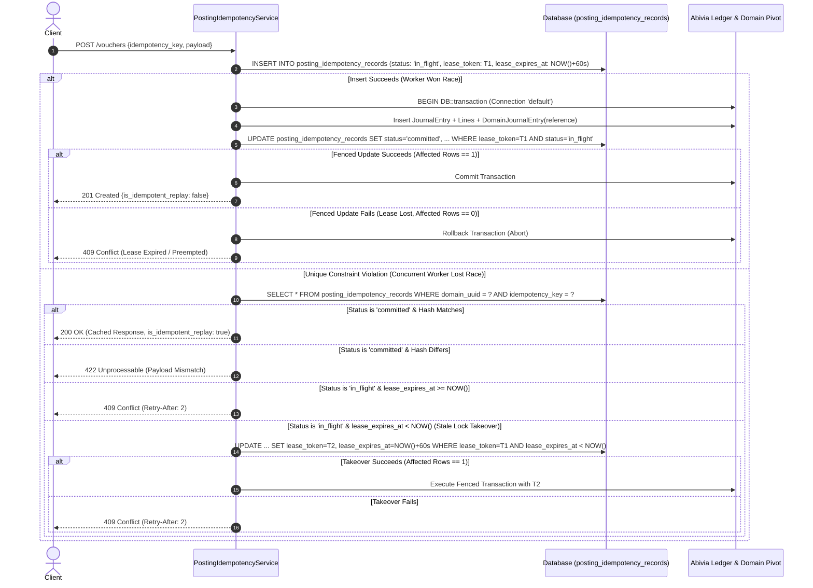
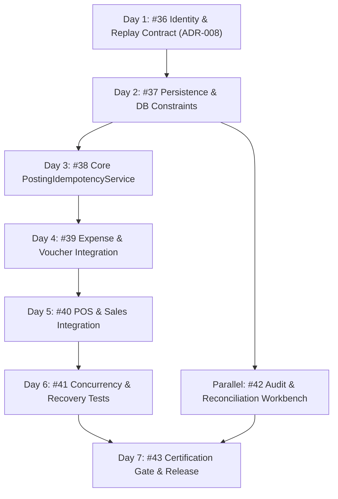

# ADR-008: Durable Posting Identity and Replay Contract

**Status**: Proposed (Under Review)  
**Date**: 2026-10-16  
**Context**: Issue #8, Issue #36 (Day 1 of DAG decomposition)  
**Parent Epic**: [Issue #8: Make posting identity and idempotency durable and concurrency-safe](https://github.com/AlamiaSoft/AlamiaAccounts/issues/8)  
**Task**: [Issue #36: Specify durable posting identity and replay contract](https://github.com/AlamiaSoft/AlamiaAccounts/issues/36)  

---

## 1. Executive Summary

In institutional double-entry accounting systems, financial mutations must enforce **strictly durable, exactly-once posting semantics**. Client retries, transient network timeouts, and concurrent requests must never generate duplicate ledger entries, corrupt ledger balances, or bypass tenant isolation boundaries.

This Architecture Decision Record (ADR) establishes the formal specification for Day 1 ([Issue #36](https://github.com/AlamiaSoft/AlamiaAccounts/issues/36)) without modifying production code or executing database migrations. It specifies:
1. **Tenant-Scoped Posting Identity & Authoritative 5-Tuple**: Strict multi-tenant isolation reconciling client-supplied lookup keys with authoritative canonical business identity `(domain_uuid, source_module, source_transaction_id, operation, version)` to prevent duplicate postings under divergent client keys.
2. **Decimal-Safe, Field-Aware Payload Fingerprinting**: Mathematical canonicalization using string/bcmath fixed-point formatting (rejecting binary float conversions), explicit company accounting-timezone resolution, and line-item tie-breaking with sequence preservation.
3. **Lease-Fenced Concurrency & Stale Reservation Protocol**: A deterministic protocol utilizing cryptographic lease tokens, monotonic generation counters, and fenced updates inside the ledger transaction, guaranteeing that reclaimed slow workers can never commit orphan transactions.
4. **Unified ACID Ledger Transaction vs. Autonomous Failure Audit**: Complete atomic cohesion across all ledger, domain pivot, idempotency, and audit rows on a single database connection, paired with an asynchronous self-healing sweeper for interrupted failure handlers.
5. **Concrete Plan for Subsequent DAG Tasks**: Clear sequencing into Tasks #37 through #43.

---

## 2. Verified Facts vs. Proposed Design Decisions

To ensure architectural integrity, this document explicitly distinguishes between **verified facts** from the current codebase and **proposed design decisions**:

| Aspect | Verified Existing Fact (Current Codebase) | Proposed Design Decision (Contract for Day 2+) |
| :--- | :--- | :--- |
| **Voucher Deduplication** | Searches `journal_entries.extra` JSON string with unindexed `LIKE` scans ([`ExpenseIntegrationService.php#L66-L71`](file:///e:/Alamia/AlamiaAccounts/AlamiaAccounts-Backend/packages/AlamiaSoft/alamia-accounts/src/Services/ExpenseIntegrationService.php#L66-L71)) or loops in memory before starting transactions ([`VoucherService.php#L70-L80`](file:///e:/Alamia/AlamiaAccounts/AlamiaAccounts-Backend/packages/AlamiaSoft/alamia-accounts/src/Services/VoucherService.php#L70-L80)). | Replace string scans with database unique constraints on `(domain_uuid, reference)` and `(domain_uuid, idempotency_key)`. |
| **Idempotency Identity Scope** | `unposted_integration_entries` defines a global unique constraint on `idempotency_key` ([migration 2026_10_15_000001](file:///e:/Alamia/AlamiaAccounts/AlamiaAccounts-Backend/packages/AlamiaSoft/alamia-accounts/database/migrations/2026_10_15_000001_create_unposted_integration_entries_table.php#L21)), creating cross-tenant collision vulnerability. | Enforce composite tenant scoping: `UNIQUE (domain_uuid, idempotency_key)` and canonical `UNIQUE (domain_uuid, source_module, source_transaction_id, operation, version)`. |
| **Failure Handling** | Only failure entries are persisted in `unposted_integration_entries`. Successful postings have no persisted idempotency record or cached response data. | Introduce `posting_idempotency_records` table to persist lifecycle status (`in_flight`, `committed`, `failed`), lease fencing metadata, and cached response payloads. |
| **Audit Records** | `AccountingAuditTrail::record(...)` executes inside or outside transactions without guaranteed survival on failure. | Separate atomic transaction audit (committed with ledger) from autonomous failure audit (survives rollback for reconciliation). |

---

## 3. Current Implementation Analysis & Gap Identification

Inspection of the existing codebase reveals four concrete architectural vulnerabilities:

### 3.1 Unindexed SQL `LIKE` Scans against JSON Metadata
* **Inspected Code**: [`ExpenseIntegrationService.php`](file:///e:/Alamia/AlamiaAccounts/AlamiaAccounts-Backend/packages/AlamiaSoft/alamia-accounts/src/Services/ExpenseIntegrationService.php#L64-L72)
```php
// Existing Flow in ExpenseIntegrationService.php:
$existingEntry = DB::table('journal_entries')
    ->join('domain_journal_entries', 'journal_entries.journalEntryId', '=', 'domain_journal_entries.journalEntryId')
    ->where('domain_journal_entries.domainUuid', $domainUuid)
    ->where('journal_entries.extra', 'like', '%"reference":"' . $reference . '"%')
    ->select('journal_entries.*')
    ->first();
```
* **Defect**:
  - Full table scan on `journal_entries.extra` (JSON serialized text).
  - Subject to substring collisions (e.g. searching for reference `"EXP-1"` matches `"EXP-10"` or `"EXP-100"`).
  - Executed outside of a row-level lock or database constraint, creating a race window between read and subsequent write.

### 3.2 In-Memory Voucher Looping Before Transaction
* **Inspected Code**: [`VoucherService.php`](file:///e:/Alamia/AlamiaAccounts/AlamiaAccounts-Backend/packages/AlamiaSoft/alamia-accounts/src/Services/VoucherService.php#L70-L80)
```php
// Existing Flow in VoucherService.php:
$refToCheck = trim($data['reference'] ?? $data['voucher_number'] ?? '');
if ($refToCheck !== '') {
    $existingVouchers = $this->getJournalEntries(['reference' => $refToCheck]);
    foreach ($existingVouchers as $ev) {
        if (strcasecmp($ev['reference'] ?? '', $refToCheck) === 0) {
            throw new Exception("Duplicate voucher reference '{$refToCheck}' is not allowed for this company");
        }
    }
}
```
* **Defect**:
  - Check occurs in PHP memory before `DB::transaction(...)` begins.
  - Two concurrent HTTP requests with reference `INV-2026-001` both execute the check before either commits, passing validation simultaneously and creating duplicate vouchers in the ledger.

### 3.3 Missing Database Unique Constraints on Voucher Reference and Domain Association
* **Inspected Migration**: [`2025_12_05_053448_create_domain_journal_entries_table.php`](file:///e:/Alamia/AlamiaAccounts/AlamiaAccounts-Backend/packages/AlamiaSoft/alamia-accounts/database/migrations/2025_12_05_053448_create_domain_journal_entries_table.php#L17-L43)
```php
// Existing domain_journal_entries schema:
$table->foreignUuid('domainUuid');
$table->unsignedBigInteger('journalEntryId');
$table->unique(['domainUuid', 'journalEntryId'], 'domain_entry_unique');
```
* **Defect**:
  - There is no `reference` column on `domain_journal_entries`.
  - The database does not enforce `UNIQUE(domainUuid, reference)`. Duplicate references within a company cannot be prevented at the storage layer.

### 3.4 Insufficiency of Error-Only Logging in `unposted_integration_entries`
* **Inspected Model**: [`UnpostedIntegrationEntry.php`](file:///e:/Alamia/AlamiaAccounts/AlamiaAccounts-Backend/packages/AlamiaSoft/alamia-accounts/src/Models/UnpostedIntegrationEntry.php#L15-L35)
* **Defect**:
  - `unposted_integration_entries` only records failed requests.
  - Successful postings have no persisted idempotency record storing the original HTTP response. A replayed request must query and reconstruct responses ad-hoc.
  - Reusing an idempotency key with a mutated payload (e.g., changing amount from \$500 to \$5,000) is not detected or audited as a security violation.

---

## 4. Tenant-Scoped Posting Identity & Authoritative Canonical Identity

### 4.1 Authoritative Business Identity vs. Client-Supplied Key
In distributed systems, a caller may provide an explicit `Idempotency-Key` (e.g., a client-generated UUID `a8c90-99f...`). However, relying solely on client-supplied keys leaves an institutional vulnerability: **a client can accidentally or maliciously supply two different idempotency keys for the same underlying business transaction** (e.g. key `K1` and key `K2` for invoice `INV-2026-9001`), leading to duplicate postings in the general ledger.

To prevent this:
1. **The Canonical 5-Tuple is Authoritative**:
   The business identity of every financial posting is defined by the 5-tuple:
   $$\text{Canonical Identity} = (\text{domain\_uuid}, \text{source\_module}, \text{source\_transaction\_id}, \text{operation}, \text{version})$$
   This tuple represents the true physical financial event.
2. **Dual Uniqueness Enforcement in Storage**:
   The `posting_idempotency_records` table enforces two separate composite unique constraints:
   - `UNIQUE (domain_uuid, idempotency_key)`: Guarantees tenant-scoped uniqueness for the primary client lookup key.
   - `UNIQUE (domain_uuid, source_module, source_transaction_id, operation, version)`: Guarantees that the underlying transaction cannot be posted twice under divergent client keys.
3. **Resolution Rule**:
   - If a request supplies a client key `K2` matching an existing record with identical canonical identity but originally posted under `K1`:
     - If payload hashes match: Return HTTP 200 with the cached response and an audit warning (`ALIASED_IDEMPOTENCY_KEY_REPLAY`).
     - If payload hashes differ: Reject with HTTP 409 Conflict (`DUPLICATE_SOURCE_TRANSACTION_MUTATION`).

### 4.2 Synthetic Canonical Keys
When a caller omits an explicit client idempotency key, the system deterministically constructs the primary lookup key from the canonical tuple:
```text
{source_module}:{company_code}:{source_transaction_id}:{operation}:{version}
```

*Example Canonical Synthetic Keys*:
- `travelos:MAIN:EXP-2026-0089:post:v1`
- `pos:KAMAL_EXPRESS:TKT-991204:post:v1`
- `voucher_ui:HOLDING:JV-2026-1044:post:v1`

### 4.3 Cross-Company Isolation Examples

To illustrate how composite uniqueness protects multi-tenant isolation, consider two distinct companies hosted on the same database cluster:

| Tenant Attribute | Company 1 (Main Entity) | Company 2 (Subsidiary Entity) |
| :--- | :--- | :--- |
| **`company_code`** | `MAIN` | `SUB_TRAVEL` |
| **`domain_uuid`** | `11111111-1111-1111-1111-111111111111` | `22222222-2222-2222-2222-222222222222` |
| **Caller Key** | `EXP-2026-10-001` | `EXP-2026-10-001` |
| **Source Tx ID** | `EXP-2026-10-001` | `EXP-2026-10-001` |

* **Scenario A: Flawed Global Uniqueness (`UNIQUE(idempotency_key)`)**:
  1. Company 1 posts expense voucher with caller key `EXP-2026-10-001`. Key is inserted globally.
  2. Company 2 independently posts their own expense voucher with their internal reference `EXP-2026-10-001`.
  3. **Failure**: Company 2's request crashes with `QueryException` (duplicate key) or falsely replays Company 1's financial transaction, causing cross-tenant data leakage or denial of service.
* **Scenario B: Proposed Composite Tenant Uniqueness (`UNIQUE(domain_uuid, idempotency_key)`)**:
  1. Company 1 posts with key `EXP-2026-10-001`. Row inserted: `('11111111-...', 'EXP-2026-10-001')`. Ledger entry created in Company 1's ledger.
  2. Company 2 posts with key `EXP-2026-10-001`. Row inserted: `('22222222-...', 'EXP-2026-10-001')`. Ledger entry created in Company 2's ledger.
  3. **Outcome**: Both transactions succeed independently with complete cryptographic and ledger isolation. Neither company can block, observe, or collide with the other.

### 4.4 Schema Reconciliation & Rollout Plan for `domain_journal_entries.reference`

The final intended constraint is strictly:
$$\text{Storage Constraint} = \text{UNIQUE}(\text{domainUuid}, \text{reference})$$

To roll this out safely across existing production data containing legacy or NULL references:
1. **Step 1 (Add Nullable Column & Index)**:
   Add `reference VARCHAR(100) NULL` to `domain_journal_entries`.
2. **Step 2 (Deterministic Backfill Migration)**:
   Execute a data migration that populates NULL references from historical records:
   - For entries where `journal_entries.extra` contains a `"reference"` JSON property, extract and assign it.
   - For legacy entries without a recorded reference, generate a deterministic fallback: `'LEGACY-' || journalEntryId`.
   - Validate that zero rows in `domain_journal_entries` have `reference IS NULL` or duplicates within the same `domainUuid`.
3. **Step 3 (Enforce Strict Unique Constraint)**:
   Apply the composite database constraint:
   `$table->unique(['domainUuid', 'reference'], 'domain_reference_unique');`
   For all new journal entries, `reference` is strictly required and non-nullable.

---

## 5. Field-Aware Deterministic Payload Fingerprinting

To detect key reuse with conflicting arguments (tampering, unintended copy-paste, or client bugs), a cryptographic SHA-256 fingerprint of the normalized request payload must be stored.

### 5.1 Decimal-Safe Monetary Normalization
Generic JSON serialization or PHP `(float)` casting is strictly prohibited for monetary amounts because binary IEEE-754 floating-point arithmetic introduces silent precision loss on large numbers (e.g. `9999999999.99` becoming `9999999999.9899999`).

Payload canonicalization enforces **strict decimal-safe normalization**:

1. **Monetary Amounts**:
   - Validated against strict decimal format regex: `/^-?\d+(\.\d+)?$/` with institutional magnitude bounds ($\le 18$ total digits, $\le 4$ decimal places).
   - Normalized using string-based arithmetic / `bcadd($val, '0', 4)`:
     - Integer and fractional parts are decomposed via string parsing.
     - Fractional part is padded or truncated to exactly 4 decimal digits: `sprintf("%s.%-04s", $integerPart, substr($fractionPart, 0, 4))`.
     - Zeroes are normalized: `0`, `0.0`, `-0.0000` all normalize to `"0.0000"`.
   - In double-entry lines, amounts are decomposed into non-negative `debit` and `credit` strings:
     `"debit": "1500.0000"`, `"credit": "0.0000"`.
2. **Account Codes & Non-Monetary Identifiers**:
   - `account_code`, `reference`, `source_transaction_id`, `tax_id`, and `cost_center` must **NEVER** be cast to float or integer.
   - Preserved as trimmed uppercase strings. For example, account code `"0110"` (Cash) remains `"0110"` and is never converted to `110`.
3. **Accounting Timezone & Calendar Dates**:
   - Accounting is partitioned by fiscal calendar dates, not UTC timestamps.
   - The company tenant profile defines the authoritative accounting timezone via `DomainContext::getTimezone($companyCode)` (e.g. `'Asia/Karachi'`).
   - When an ISO-8601 datetime with explicit offset/UTC is provided (e.g. `2026-10-16T22:30:00Z` or `+05:00`), it is parsed and converted to the company's accounting timezone before truncating to the calendar date `YYYY-MM-DD`.
   - Date-only strings (`YYYY-MM-DD`) are preserved directly as the accounting date.
4. **Currencies**:
   - Trimmed uppercase 3-letter ISO-4217 code (e.g., `"PKR"`, `"USD"`).
   - If omitted, normalized to the domain's default currency resolved via `DomainContext::getDefaultCurrency()`.
5. **Account Intent vs. Dynamic Mappings**:
   - When a high-level intent is passed (e.g. `category: "office_supplies"`), the fingerprint hashes both:
     - The input intent: `category => "office_supplies"`
     - The resolved target ledger account: `resolved_debit_account => "4200"`
     If an accountant reconfigures category mappings in company settings between retries, the fingerprint changes, preventing silent posting to a different ledger account under the same key.
6. **Line Items & Deterministic Tie-Breaking**:
   - Each line item is projected into a complete canonical schema:
     `[account_code, debit_str, credit_str, description, memo, cost_center, tax_code, line_index]`
   - Sorted deterministically using composite comparison:
     1. `account_code ASC`
     2. `debit_str ASC`
     3. `credit_str ASC`
     4. `description ASC`
     5. `cost_center ASC`
     6. `tax_code ASC`
     7. `line_index ASC` (preserves original input sequence for duplicate lines)
7. **Quantities**:
   - Integer quantities remain integer strings (`"1"`, `"5"`). Fractional quantities (e.g. units of service) are normalized to fixed 4-decimal precision.
8. **Transient Field Elimination**:
   - Transport metadata excluded from fingerprint:
     `['idempotency_key', 'timestamp', 'request_time', 'current_time', 'request_id', '_token', 'created_at', 'updated_at', 'agent_notes_transient']`.

### 5.2 Mathematical Fingerprint Contract & Qualified Equality

$$\text{payload\_hash} = \text{SHA256}(\text{CanonicalJson}(\text{Normalize}(P)))$$

The equality claim:
$$\text{payload\_hash}(P_1) = \text{payload\_hash}(P_2) \iff \text{SemanticAccountingEquality}(P_1, P_2)$$
is formally qualified as follows:
1. **Cryptographic Collision Resistance**: SHA-256 provides collision probability $< 2^{-128}$ against birthday attacks, rendering hash collisions practically impossible.
2. **Canonical Domain Projection**: Semantic accounting equality is evaluated strictly over the projected business attributes. Discarded transient transport fields (such as client request timestamps) are intentionally non-semantic for accounting ledger records.

---

## 6. Lease-Fenced Concurrency Protocol & Stale Reservation Takeover



### 6.1 Why a Fixed Age Check is Insufficient
A simple elapsed-time check (`created_at > 30s`) does not prove a worker has crashed. A slow but healthy worker (e.g. stalled on a large balance calculation, GC pause, or database lock wait) may take longer than 30 seconds. If a second worker takes over based on elapsed time alone without fencing, **both workers could attempt to commit ledger rows simultaneously**, producing double-postings or corrupted ledger states.

### 6.2 Ownership Fencing Protocol & Monotonic Generation
To prevent dual-master posting races, every reservation uses **cryptographic lease tokens and optimistic fencing**:

1. **Reservation Token & Monotonic Generation**:
   - `lease_token`: Cryptographic UUIDv4 generated by the worker claiming the lease.
   - `lease_generation`: Monotonically incrementing integer counter tracking ownership handoffs.
   - `lease_expires_at`: Absolute timestamp (`NOW() + 60s`).
2. **Pre-Transaction Autonomous Reservation (`INSERT`)**:
   ```sql
   INSERT INTO posting_idempotency_records (
       domain_uuid, company_code, idempotency_key, payload_hash,
       source_module, source_transaction_id, operation, version,
       request_payload, status, lease_token, lease_generation,
       lease_expires_at, created_at, updated_at
   ) VALUES (?, ?, ?, ?, ?, ?, ?, ?, ?, 'in_flight', :token1, 1, NOW() + INTERVAL 60 SECOND, NOW(), NOW());
   ```
3. **Atomic Takeover of Stale Leases (Conditional Fenced Update)**:
   If a worker encounters `status === 'in_flight'` and `lease_expires_at < NOW()`, it attempts an atomic takeover:
   ```sql
   UPDATE posting_idempotency_records
   SET lease_token = :token2,
       lease_generation = lease_generation + 1,
       lease_expires_at = NOW() + INTERVAL 60 SECOND,
       status = 'in_flight',
       payload_hash = :hash,
       updated_at = NOW()
   WHERE domain_uuid = :domainUuid
     AND idempotency_key = :key
     AND status = 'in_flight'
     AND lease_expires_at < NOW()
     AND lease_token = :observedToken;
   ```
   - If `affected_rows === 1`: Worker 2 acquired exclusive ownership.
   - If `affected_rows === 0`: Another worker won the takeover race or the lease was renewed; Worker 2 rejects with HTTP 409 Conflict (`Retry-After: 2`).
4. **Lease Renewal (Heartbeat)**:
   For long-running batch postings, the worker periodically renews its lease before expiration:
   ```sql
   UPDATE posting_idempotency_records
   SET lease_expires_at = NOW() + INTERVAL 60 SECOND, updated_at = NOW()
   WHERE id = :id AND lease_token = :myToken AND status = 'in_flight';
   ```
5. **Fenced Commit inside the Ledger Transaction**:
   Inside `DB::transaction(...)`:
   ```sql
   UPDATE posting_idempotency_records
   SET status = 'committed',
       voucher_reference = :voucherRef,
       journal_entry_id = :jeId,
       response_data = :responseData,
       updated_at = NOW()
   WHERE domain_uuid = :domainUuid
     AND idempotency_key = :key
     AND lease_token = :myToken
     AND status = 'in_flight';
   ```
   - **The Fencing Invariant**: If Worker 1 was slow and Worker 2 took over its lease, Worker 1's `lease_token` no longer matches. The `UPDATE` modifies **0 rows**.
   - Worker 1 checks `affected_rows === 0`, throws `IdempotencyLeaseFencingException`, and **aborts its entire ledger transaction**. Zero ledger entries are persisted by the preempted worker.

---

## 7. Unified ACID Ledger Transaction vs. Autonomous Failure Audit

### 7.1 Single Database Connection & Unified ACID Transaction Boundary
All participating tables—Abivia Ledger (`journal_entries`, `journal_entry_lines`, `domain_journal_entries`), Alamia Idempotency (`posting_idempotency_records`), and Audit (`accounting_audit_trails`)—reside on the primary database connection (`DB::connection('default')`).

The entire posting mutation executes inside a single `DB::transaction(...)`:
1. Insert Journal Entry & lines in Abivia Ledger.
2. Insert Domain Pivot in `domain_journal_entries` with `reference`.
3. Fenced status transition of `posting_idempotency_records` to `'committed'` matching `lease_token`.
4. Insert success record in `accounting_audit_trails` (`CREATE_VOUCHER`).

**Cohesion Guarantee**: Because the status update to `'committed'` is executed **inside the same ACID transaction** as the ledger rows, there is **zero crash window** between the ledger rows and the committed idempotency state. Either all four entities commit atomically, or all four roll back together.

### 7.2 Autonomous Failure Handling & Catch Block Semantics
When an exception occurs during the ledger transaction (e.g. unbalanced debits/credits, closed period, non-leaf category posting, or lease fencing violation), the database rolls back completely.

In an independent `catch (Throwable $e)` block outside the rolled-back transaction:
1. Attempt a fenced failure transition:
   ```sql
   UPDATE posting_idempotency_records
   SET status = 'failed', error_message = :errorMessage, updated_at = NOW()
   WHERE id = :id AND lease_token = :myToken AND status = 'in_flight';
   ```
2. Insert durable failure entry into `unposted_integration_entries` (`status = 'failed'`, `retry_count = 1`, `error_message`, `payload`).
3. Insert audit log into `accounting_audit_trails` (`INTEGRATION_POSTING_FAILED`).

### 7.3 Interruption Recovery for the Failure Handler
If the failure handler itself crashes (e.g. SIGKILL, container eviction, OOM, power loss, or database connection severed during the `catch` block):

* **Interruption State**: The database record in `posting_idempotency_records` remains in `status = 'in_flight'` with its `lease_expires_at` in the past. Zero ledger entries exist in the ledger (because the business transaction was completely rolled back).
* **Self-Healing Recovery**:
  1. **Reactive Recovery on Client Retry**:
     When the client retries after timeout, `lease_expires_at` is expired. The worker enters Case C (Stale Takeover), verifies that no ledger row exists in `domain_journal_entries`, reclaims the lease with a new token, and executes cleanly.
  2. **Proactive Reconciliation Sweeper (`ReconcileStaleInFlightPostingsJob`)**:
     A background artisan job runs periodically (every 5 minutes):
     ```sql
     SELECT * FROM posting_idempotency_records
     WHERE status = 'in_flight' AND lease_expires_at < NOW() - INTERVAL 5 MINUTE;
     ```
     For each stranded record:
     - It queries `domain_journal_entries` by `(domainUuid, reference)`.
     - Because the business transaction rolled back, no journal entry exists.
     - The sweeper safely transitions the record to `status = 'failed'` (`error_message = 'Interrupted: worker terminated before completion'`), inserts an entry into `unposted_integration_entries`, and emits an accountant alert.

---

## 8. Proposed Database Schema Changes (for Day 2 / Issue #37)

### 8.1 Table: `posting_idempotency_records`
```php
Schema::create('posting_idempotency_records', function (Blueprint $table) {
    $table->id();
    $table->string('domain_uuid', 36)->index();
    $table->string('company_code', 50)->index();
    $table->string('idempotency_key', 191);
    $table->string('source_module', 50)->default('integration')->index();
    $table->string('source_transaction_id', 100)->nullable()->index();
    $table->string('operation', 50)->default('post');
    $table->string('version', 20)->default('v1');
    $table->string('payload_hash', 64)->index();
    $table->json('request_payload')->nullable();
    $table->string('status', 30)->default('in_flight')->index(); // in_flight, committed, failed
    $table->string('lease_token', 64)->nullable()->index();
    $table->unsignedBigInteger('lease_generation')->default(1);
    $table->timestamp('lease_expires_at')->nullable()->index();
    $table->string('voucher_reference', 100)->nullable()->index();
    $table->unsignedBigInteger('journal_entry_id')->nullable()->index();
    $table->json('response_data')->nullable();
    $table->text('error_message')->nullable();
    $table->timestamps();

    // Tenant-scoped client lookup unique constraint
    $table->unique(['domain_uuid', 'idempotency_key'], 'domain_idempotency_unique');

    // Authoritative canonical 5-tuple unique constraint
    $table->unique(
        ['domain_uuid', 'source_module', 'source_transaction_id', 'operation', 'version'],
        'domain_canonical_identity_unique'
    );

    $table->index(['company_code', 'status']);
});
```

### 8.2 Alter Table: `domain_journal_entries` (With Migration Rollout)
```php
// Step 1: Add reference column
Schema::table('domain_journal_entries', function (Blueprint $table) {
    if (!Schema::hasColumn('domain_journal_entries', 'reference')) {
        $table->string('reference', 100)->nullable()->after('journalEntryId')->index();
    }
});

// Step 2: Data Backfill in Migration
DB::statement("
    UPDATE domain_journal_entries
    SET reference = COALESCE(
        (SELECT JSON_UNQUOTE(JSON_EXTRACT(extra, '$.reference')) FROM journal_entries WHERE journal_entries.journalEntryId = domain_journal_entries.journalEntryId),
        CONCAT('LEGACY-', journalEntryId)
    )
    WHERE reference IS NULL OR reference = ''
");

// Step 3: Enforce strict composite unique constraint
Schema::table('domain_journal_entries', function (Blueprint $table) {
    $table->unique(['domainUuid', 'reference'], 'domain_reference_unique');
});
```

### 8.3 Alter Table: `operational_sales`
```php
Schema::table('operational_sales', function (Blueprint $table) {
    $table->unique(['company_code', 'idempotency_key'], 'op_sales_company_idempotency_unique');
});
```

---

## 9. Plan for Subsequent Daily Tasks in the Issue #8 DAG



| Task | Day | Title & Deliverable |
| :--- | :---: | :--- |
| **[#36](https://github.com/AlamiaSoft/AlamiaAccounts/issues/36)** | **Day 1** | **Current Task**: Reviewable ADR-008 (Proposed) with pure contract/documentation. |
| **[#37](https://github.com/AlamiaSoft/AlamiaAccounts/issues/37)** | **Day 2** | Add `posting_idempotency_records` table, unique constraints on `domain_journal_entries` and `operational_sales`, and model tests. |
| **[#38](https://github.com/AlamiaSoft/AlamiaAccounts/issues/38)** | **Day 3** | Implement core `PostingIdempotencyService` with decimal-safe normalization, lease fencing, and atomic transaction wrapper. |
| **[#39](https://github.com/AlamiaSoft/AlamiaAccounts/issues/39)** | **Day 4** | Refactor `ExpenseIntegrationService` and `VoucherService` to eliminate all JSON string scans. |
| **[#40](https://github.com/AlamiaSoft/AlamiaAccounts/issues/40)** | **Day 5** | Refactor `SalesIntegrationService` to enforce stable identity, replay, and payload mismatch rejection. |
| **[#41](https://github.com/AlamiaSoft/AlamiaAccounts/issues/41)** | **Day 6** | Comprehensive concurrency and recovery regression test suite (SQLite & PostgreSQL). |
| **[#42](https://github.com/AlamiaSoft/AlamiaAccounts/issues/42)** | **Parallel** | Audit trail correlation and unposted entry reconciliation tools. |
| **[#43](https://github.com/AlamiaSoft/AlamiaAccounts/issues/43)** | **Day 7** | Certification gate and evidence-based sign-off for Issue #8 closure. |

---

## 10. Learning Capture Review

1. **Dual Uniqueness for Client Keys vs. Authoritative Business Identity**:
   Enforcing uniqueness on client-supplied idempotency keys alone allows callers to post duplicate vouchers by varying the client key. Dual uniqueness (`UNIQUE(domain_uuid, idempotency_key)` AND `UNIQUE(domain_uuid, source_module, source_transaction_id, operation, version)`) prevents duplicate ledger transactions regardless of caller key divergence.
2. **Optimistic Fencing for Distributed Concurrency**:
   Elapsed-time checks without cryptographic lease tokens create split-brain race conditions when workers experience latency. Enforcing an optimistic fencing token inside the final transaction update ensures that preempted workers can never commit ledger entries.
3. **Decimal-Safe String Formatting**:
   Monetary hashing must never cast to binary float due to IEEE-754 precision loss on high-magnitude values. String-based decomposition or `bcmath` ensures 100% deterministic mathematical equality across all platforms.
