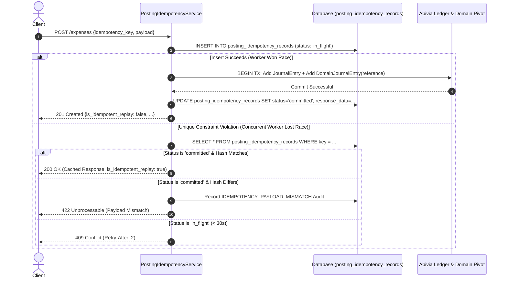
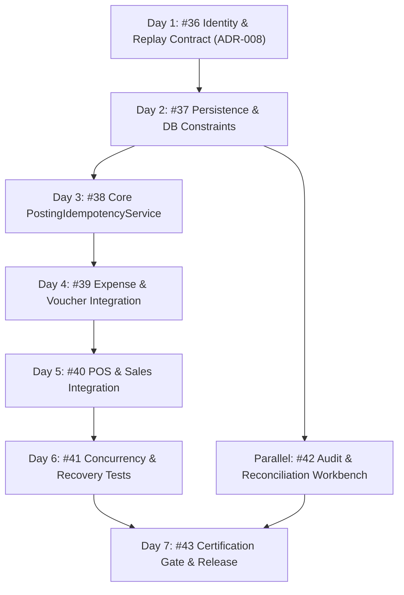

# ADR-008: Durable Posting Identity and Replay Contract

**Status**: Proposed (Under Review)  
**Date**: 2026-10-16  
**Context**: Issue #8, Issue #36 (Day 1 of DAG decomposition)  
**Parent Epic**: [Issue #8: Make posting identity and idempotency durable and concurrency-safe](https://github.com/AlamiaSoft/AlamiaAccounts/issues/8)  
**Task**: [Issue #36: Specify durable posting identity and replay contract](https://github.com/AlamiaSoft/AlamiaAccounts/issues/36)  

---

## 1. Executive Summary

In institutional double-entry accounting systems, financial mutations must enforce **strictly durable, exactly-once posting semantics**. Client retries, transient network timeouts, and concurrent requests must never generate duplicate ledger entries, corrupt ledger balances, or bypass tenant isolation boundaries.

This Architecture Decision Record (ADR) establishes the formal specification for Day 1 ([Issue #36](https://github.com/AlamiaSoft/AlamiaAccounts/issues/36)) without modifying production code or executing database migrations. It specifies:
1. **Tenant-Scoped Posting Identity**: A composite identity guaranteeing strict tenant isolation and reconciling client-supplied keys with backend-generated identity keys.
2. **Deterministic, Field-Aware Payload Fingerprinting**: Mathematical canonicalization across monetary amounts, calendar dates, currencies, account codes, and sorted line items.
3. **Database Reservation, Locking & Concurrency-Loser Protocol**: A deterministic protocol for reserving keys, catching unique constraint violations, and responding to concurrent race conditions.
4. **Separation of Atomic Posting vs. Durable Failure Records**: Precise rollback semantics ensuring ledger entries never commit partially, while failure and audit records survive rollback for accountant reconciliation.
5. **Concrete Plan for Subsequent DAG Tasks**: Clear sequencing into Tasks #37 through #43.

---

## 2. Verified Facts vs. Proposed Design Decisions

To ensure architectural integrity, this document explicitly distinguishes between **verified facts** from the current codebase and **proposed design decisions**:

| Aspect | Verified Existing Fact (Current Codebase) | Proposed Design Decision (Contract for Day 2+) |
| :--- | :--- | :--- |
| **Voucher Deduplication** | Searches `journal_entries.extra` JSON string with unindexed `LIKE` scans ([`ExpenseIntegrationService.php#L66-L71`](file:///e:/Alamia/AlamiaAccounts/AlamiaAccounts-Backend/packages/AlamiaSoft/alamia-accounts/src/Services/ExpenseIntegrationService.php#L66-L71)) or loops in memory before starting transactions ([`VoucherService.php#L70-L80`](file:///e:/Alamia/AlamiaAccounts/AlamiaAccounts-Backend/packages/AlamiaSoft/alamia-accounts/src/Services/VoucherService.php#L70-L80)). | Replace string scans with database unique constraints on `(domain_uuid, reference)` and `(domain_uuid, idempotency_key)`. |
| **Idempotency Identity Scope** | `unposted_integration_entries` defines a global unique constraint on `idempotency_key` ([migration 2026_10_15_000001](file:///e:/Alamia/AlamiaAccounts/AlamiaAccounts-Backend/packages/AlamiaSoft/alamia-accounts/database/migrations/2026_10_15_000001_create_unposted_integration_entries_table.php#L21)), creating cross-tenant collision vulnerability. | Enforce composite tenant scoping: `UNIQUE (domain_uuid, idempotency_key)`. |
| **Failure Handling** | Only failure entries are persisted in `unposted_integration_entries`. Successful postings have no persisted idempotency record or cached response data. | Introduce `posting_idempotency_records` table to persist lifecycle status (`in_flight`, `committed`, `failed`) and cached response payloads. |
| **Audit Records** | `AccountingAuditTrail::record(...)` executes inside or outside transactions without guaranteed survival on failure. | Separate atomic transaction audit (committed with ledger) from autonomous failure audit (survives rollback for reconciliation). |

---

## 3. Current Implementation Analysis & Gap Identification

Inspection of the existing codebase reveals four concrete architectural vulnerabilities:

### 3.1 Unindexed SQL `LIKE` Scans against JSON Metadata
* **Inspected Code**: [`ExpenseIntegrationService.php`](file:///e:/Alamia/AlamiaAccounts/AlamiaAccounts-Backend/packages/AlamiaSoft/alamia-accounts/src/Services/ExpenseIntegrationService.php#L64-L72)
```php
// Existing Flow in ExpenseIntegrationService.php:
$existingEntry = DB::table('journal_entries')
    ->join('domain_journal_entries', 'journal_entries.journalEntryId', '=', 'domain_journal_entries.journalEntryId')
    ->where('domain_journal_entries.domainUuid', $domainUuid)
    ->where('journal_entries.extra', 'like', '%"reference":"' . $reference . '"%')
    ->select('journal_entries.*')
    ->first();
```
* **Defect**:
  - Full table scan on `journal_entries.extra` (JSON serialized text).
  - Subject to substring collisions (e.g. searching for reference `"EXP-1"` matches `"EXP-10"` or `"EXP-100"`).
  - Executed outside of a row-level lock or database constraint, creating a race window between read and subsequent write.

### 3.2 In-Memory Voucher Looping Before Transaction
* **Inspected Code**: [`VoucherService.php`](file:///e:/Alamia/AlamiaAccounts/AlamiaAccounts-Backend/packages/AlamiaSoft/alamia-accounts/src/Services/VoucherService.php#L70-L80)
```php
// Existing Flow in VoucherService.php:
$refToCheck = trim($data['reference'] ?? $data['voucher_number'] ?? '');
if ($refToCheck !== '') {
    $existingVouchers = $this->getJournalEntries(['reference' => $refToCheck]);
    foreach ($existingVouchers as $ev) {
        if (strcasecmp($ev['reference'] ?? '', $refToCheck) === 0) {
            throw new Exception("Duplicate voucher reference '{$refToCheck}' is not allowed for this company");
        }
    }
}
```
* **Defect**:
  - Check occurs in PHP memory before `DB::transaction(...)` begins.
  - Two concurrent HTTP requests with reference `INV-2026-001` both execute the check before either commits, passing validation simultaneously and creating duplicate vouchers in the ledger.

### 3.3 Missing Database Unique Constraints on Voucher Reference and Domain Association
* **Inspected Migration**: [`2025_12_05_053448_create_domain_journal_entries_table.php`](file:///e:/Alamia/AlamiaAccounts/AlamiaAccounts-Backend/packages/AlamiaSoft/alamia-accounts/database/migrations/2025_12_05_053448_create_domain_journal_entries_table.php#L17-L43)
```php
// Existing domain_journal_entries schema:
$table->foreignUuid('domainUuid');
$table->unsignedBigInteger('journalEntryId');
$table->unique(['domainUuid', 'journalEntryId'], 'domain_entry_unique');
```
* **Defect**:
  - There is no `reference` column on `domain_journal_entries`.
  - The database does not enforce `UNIQUE(domainUuid, reference)`. Duplicate references within a company cannot be prevented at the storage layer.

### 3.4 Insufficiency of Error-Only Logging in `unposted_integration_entries`
* **Inspected Model**: [`UnpostedIntegrationEntry.php`](file:///e:/Alamia/AlamiaAccounts/AlamiaAccounts-Backend/packages/AlamiaSoft/alamia-accounts/src/Models/UnpostedIntegrationEntry.php#L15-L35)
* **Defect**:
  - `unposted_integration_entries` only records failed requests.
  - Successful postings have no persisted idempotency record storing the original HTTP response. A replayed request must query and reconstruct responses ad-hoc.
  - Reusing an idempotency key with a mutated payload (e.g., changing amount from \$500 to \$5,000) is not detected or audited as a security violation.

---

## 4. Tenant-Scoped Posting Identity Specification

### 4.1 Tenant Scoping vs. Global Uniqueness
In multi-tenant SaaS accounting, idempotency **must always be tenant-scoped**. Enforcing global uniqueness on raw client-supplied keys (e.g. `UUID` or `invoice_123`) would allow Tenant A to unintentionally or maliciously deny service to Tenant B by reserving their keys.

Therefore, the database constraint must be composite:

$$\text{Storage Constraint} = \text{UNIQUE}(\text{domain\_uuid}, \text{idempotency\_key})$$

### 4.2 Reconciling Client-Supplied vs. Synthetic Canonical Keys
A request may provide an idempotency key through two channels:
1. **Client-Supplied Header**: HTTP `Idempotency-Key` or payload `idempotency_key`.
2. **System-Generated Synthetic Key**: Derived when no explicit key is supplied.

To reconcile both models cleanly:
* The `idempotency_key` column stores the primary lookup key (either client-supplied or synthetic).
* The record also stores the structured 5-tuple identity columns for audit correlation:
  - `source_module`: e.g. `pos`, `travelos`, `api`, `copilot`
  - `company_code`: target company tenant code (normalized uppercase)
  - `domain_uuid`: LedgerDomain foreign UUID
  - `source_transaction_id`: external invoice/ticket/reference ID
  - `operation`: financial action (`post`, `reverse`, `amend`)
  - `version`: contract schema revision (`v1`)

When synthetic keys are generated, they follow the canonical serialized format:
```text
{source_module}:{company_code}:{source_transaction_id}:{operation}:{version}
```
*Example Synthetic Keys*:
- `travelos:MAIN:EXP-2026-0089:post:v1`
- `pos:KAMAL_EXPRESS:TKT-991204:post:v1`

---

## 5. Field-Aware Deterministic Payload Fingerprinting

To detect key reuse with conflicting arguments (tampering, unintended copy-paste, or client bugs), a cryptographic SHA-256 fingerprint of the normalized request payload must be stored.

### 5.1 Field-by-Field Normalization Rules
Generic JSON serialization is insufficient because floating-point numbers, whitespace, and key ordering introduce false mismatches. Payload canonicalization must be **field-aware**:

1. **Monetary Amounts**:
   - Normalized to fixed-point strings with 4 decimal places: `number_format((float)$val, 4, '.', '')`.
   - Zeroes are normalized: `0.0000`, `0`, and `-0.0000` all normalize to `"0.0000"`.
   - In double-entry lines, amounts are decomposed into non-negative `debit` and `credit` strings:
     `"debit": "1500.0000"`, `"credit": "0.0000"`.
2. **Calendar Dates**:
   - Normalized to ISO-8601 calendar date format `YYYY-MM-DD` (e.g., `"2026-10-16"`).
   - Any time or timezone component is parsed and truncated to the accounting transaction date.
3. **Currencies**:
   - Trimmed uppercase 3-letter ISO-4217 code (e.g., `"PKR"`, `"USD"`).
   - If omitted, normalized to the domain's default currency resolved via `DomainContext::getDefaultCurrency()`.
4. **Account Codes & Dynamic Mappings**:
   - Explicit account codes are trimmed and normalized to uppercase strings (e.g., `"1110"`, `"1200"`).
   - When a high-level intent is passed (e.g. `category: "office_supplies"`), the fingerprint hashes both:
     - The input intent: `category => "office_supplies"`
     - The resolved target ledger account: `resolved_debit_account => "4200"`
     If an accountant reconfigures the category mapping in company settings between retries, the fingerprint changes, preventing silent posting to a different ledger account under the same key.
5. **Line Items & Sorting**:
   - Line items are sorted deterministically before hashing using composite sorting:
     `account_code ASC`, then `debit ASC`, then `credit ASC`, then `description ASC`.
   - This ensures that line order permutation does not cause false-positive payload mismatches.
6. **Transient Field Elimination**:
   - The following transport/metadata fields are explicitly excluded from the fingerprint:
     `['idempotency_key', 'timestamp', 'request_time', 'current_time', 'request_id', '_token', 'created_at', 'updated_at', 'agent_notes_transient']`.

### 5.2 Mathematical Fingerprint Contract
$$\text{payload\_hash} = \text{SHA256}(\text{CanonicalJson}(\text{Normalize}(P)))$$

$$\text{payload\_hash}(P_1) = \text{payload\_hash}(P_2) \iff \text{SemanticAccountingEquality}(P_1, P_2)$$

---

## 6. Database Reservation, Locking & Concurrency Protocol



### 6.1 Reservation Protocol
1. **Pre-Transaction Autonomous Reservation**:
   - Before opening the ledger transaction, the service attempts an `INSERT` into `posting_idempotency_records` with `status = 'in_flight'` and `payload_hash = $hash`.
   - The database unique constraint `UNIQUE (domain_uuid, idempotency_key)` serves as the distributed atomic mutex.
2. **Winner Execution**:
   - The winning process proceeds immediately to execute the accounting transaction inside `DB::transaction(...)`.
3. **Concurrent-Loser Protocol**:
   - Any concurrent request with the same `(domain_uuid, idempotency_key)` receives a `QueryException` (SQLSTATE 23505 / 23000 / 19).
   - The loser catches the exception and inspects the existing record:
     - **Case A (`status === 'committed'`)**: Compare payload hash. If match, return HTTP 200 with cached response (`is_idempotent_replay: true`). If mismatch, return HTTP 422 (`IdempotencyPayloadMismatchException`).
     - **Case B (`status === 'in_flight'`)**: If the record was created recently (< 30 seconds ago), return HTTP 409 Conflict with header `Retry-After: 2` and error code `idempotency_conflict_in_flight`.
     - **Case C (`status === 'failed'`)**: Allow controlled re-execution.

---

## 7. Separation of Atomic Ledger Posting vs. Durable Failure Records

Accounting transactions require strict separation between what must roll back together and what must survive rollback:

### 7.1 Atomic Transaction Boundary (All-or-Nothing Commit)
The following operations execute strictly inside `DB::transaction(...)`:
1. Journal Entry creation in Abivia Ledger (`journal_entries`, `journal_entry_lines`).
2. Domain association in `domain_journal_entries` with `reference` (enforces `UNIQUE (domainUuid, reference)`).
3. Transition of `posting_idempotency_records` to `status = 'committed'`, storing `voucher_reference`, `journal_entry_id`, and `response_data`.
4. Successful posting audit record in `accounting_audit_trails` (`CREATE_VOUCHER` / `INTEGRATION_POSTED`).

**Rollback Guarantee**: If any constraint fails (unbalanced debits/credits, closed period, non-leaf category posting, or duplicate voucher reference), the transaction aborts completely. Zero ledger entries or domain associations are persisted.

### 7.2 Autonomous Durable Failure Boundary (Survives Rollback)
When an exception occurs during ledger posting, the transaction rolls back. An independent `catch (Throwable $e)` block executes outside the failed transaction to guarantee auditability:
1. `posting_idempotency_records` is updated to `status = 'failed'` with `error_message = $e->getMessage()`.
2. A durable failure entry is inserted into `unposted_integration_entries` (`status = 'failed'`, `retry_count = 1`, `error_message`, `payload`).
3. An audit record is written to `accounting_audit_trails` with action `INTEGRATION_POSTING_FAILED`.

This ensures that accountants can view, diagnose, and reprocess failed entries via the reconciliation workbench without leaving orphaned transactions in the general ledger.

---

## 8. Proposed Database Schema Changes (for Day 2 / Issue #37)

The persistence layer implementation for Day 2 will introduce the following concrete schema definitions:

### 8.1 Table: `posting_idempotency_records`
```php
Schema::create('posting_idempotency_records', function (Blueprint $table) {
    $table->id();
    $table->string('domain_uuid', 36)->index();
    $table->string('company_code', 50)->index();
    $table->string('idempotency_key', 191);
    $table->string('source_module', 50)->default('integration')->index();
    $table->string('source_transaction_id', 100)->nullable()->index();
    $table->string('operation', 50)->default('post');
    $table->string('version', 20)->default('v1');
    $table->string('payload_hash', 64)->index();
    $table->json('request_payload')->nullable();
    $table->string('status', 30)->default('in_flight')->index(); // in_flight, committed, failed
    $table->string('voucher_reference', 100)->nullable()->index();
    $table->unsignedBigInteger('journal_entry_id')->nullable()->index();
    $table->json('response_data')->nullable();
    $table->text('error_message')->nullable();
    $table->timestamps();

    // Tenant-scoped unique constraint
    $table->unique(['domain_uuid', 'idempotency_key'], 'domain_idempotency_unique');
    $table->index(['company_code', 'status']);
});
```

### 8.2 Alter Table: `domain_journal_entries`
```php
Schema::table('domain_journal_entries', function (Blueprint $table) {
    if (!Schema::hasColumn('domain_journal_entries', 'reference')) {
        $table->string('reference', 100)->nullable()->after('journalEntryId')->index();
    }
    $table->unique(['domainUuid', 'reference'], 'domain_reference_unique');
});
```

### 8.3 Alter Table: `operational_sales`
```php
Schema::table('operational_sales', function (Blueprint $table) {
    $table->unique(['company_code', 'idempotency_key'], 'op_sales_company_idempotency_unique');
});
```

---

## 9. Plan for Subsequent Daily Tasks in the Issue #8 DAG

This specification serves as the formal gate for the daily task breakdown:



| Task | Day | Title & Deliverable |
| :--- | :---: | :--- |
| **[#36](https://github.com/AlamiaSoft/AlamiaAccounts/issues/36)** | **Day 1** | **Current Task**: Reviewable ADR-008 (Proposed) with pure contract/documentation. |
| **[#37](https://github.com/AlamiaSoft/AlamiaAccounts/issues/37)** | **Day 2** | Add `posting_idempotency_records` table, unique constraints on `domain_journal_entries` and `operational_sales`, and model tests. |
| **[#38](https://github.com/AlamiaSoft/AlamiaAccounts/issues/38)** | **Day 3** | Implement core `PostingIdempotencyService` with field-aware normalization, reservation, and atomic transaction wrapper. |
| **[#39](https://github.com/AlamiaSoft/AlamiaAccounts/issues/39)** | **Day 4** | Refactor `ExpenseIntegrationService` and `VoucherService` to eliminate all JSON string scans. |
| **[#40](https://github.com/AlamiaSoft/AlamiaAccounts/issues/40)** | **Day 5** | Refactor `SalesIntegrationService` to enforce stable identity, replay, and payload mismatch rejection. |
| **[#41](https://github.com/AlamiaSoft/AlamiaAccounts/issues/41)** | **Day 6** | Comprehensive concurrency and recovery regression test suite (SQLite & PostgreSQL). |
| **[#42](https://github.com/AlamiaSoft/AlamiaAccounts/issues/42)** | **Parallel** | Audit trail correlation and unposted entry reconciliation tools. |
| **[#43](https://github.com/AlamiaSoft/AlamiaAccounts/issues/43)** | **Day 7** | Certification gate and evidence-based sign-off for Issue #8 closure. |

---

## 10. Learning Capture Review

1. **Multi-Tenant Constraint Scoping**:
   Global unique constraints on client-supplied idempotency keys violate tenant isolation. All idempotency constraints must be composite with `domain_uuid` or `company_code`.
2. **Fixed-Point Formatting in PHP**:
   Standard `json_encode` in PHP serializes floats with variable trailing zeros (e.g. `500.0` vs `500.00`). Hashing requires explicit formatting with `number_format((float)$val, 4, '.', '')` to avoid false-positive payload mismatches.
3. **Autonomous Failure Survival**:
   In Laravel, recording failures inside a transaction that subsequently rolls back causes the failure record itself to be discarded. Failure logging must execute in an independent catch block outside the rolled-back transaction.
