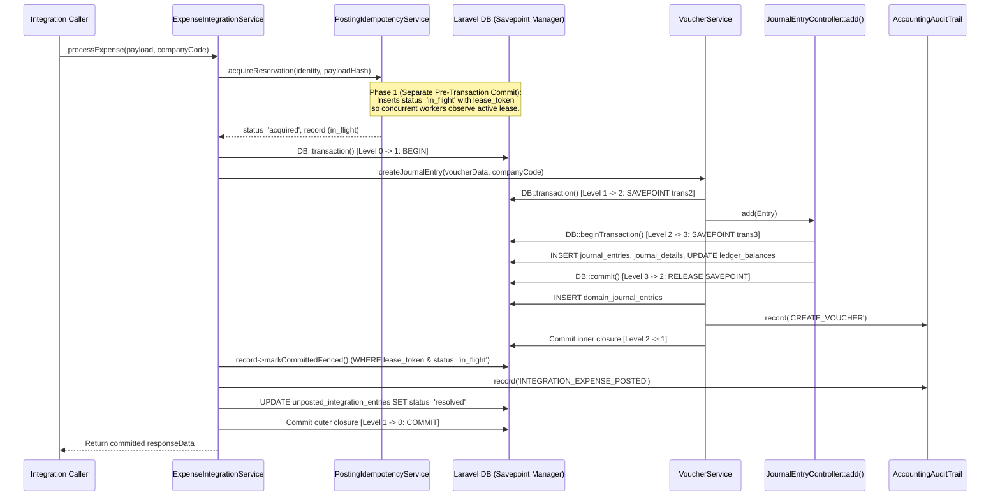

# Posting Transaction & Connection Boundary Specification (Issue #40)

**Status:** Implemented & Verified (Issue [#40](https://github.com/AlamiaSoft/AlamiaAccounts/issues/40), Parent [#8](https://github.com/AlamiaSoft/AlamiaAccounts/issues/8))  
**Date:** 2026-10-22  

---

## 1. Database Connection Topology

All core accounting models in `abivia/ledger` and `alamiasoft/alamia-accounts` extend `Illuminate\Database\Eloquent\Model` without overriding `$connection`, and all raw/transactional calls use the default `Illuminate\Support\Facades\DB` facade (`DB::connection()`):

| Layer | Model / Class | Table | Connection |
| :--- | :--- | :--- | :--- |
| **Abivia Ledger Kernel** | `Abivia\Ledger\Models\JournalEntry` | `journal_entries` | Default (`sqlite` / `pgsql`) |
| **Abivia Ledger Kernel** | `Abivia\Ledger\Models\JournalDetail` | `journal_details` | Default (`sqlite` / `pgsql`) |
| **Abivia Ledger Kernel** | `Abivia\Ledger\Models\LedgerBalance` | `ledger_balances` | Default (`sqlite` / `pgsql`) |
| **Alamia Domain Association** | `AlamiaSoft\AlamiaAccounts\Models\DomainJournalEntry` | `domain_journal_entries` | Default (`sqlite` / `pgsql`) |
| **Alamia Idempotency** | `AlamiaSoft\AlamiaAccounts\Models\PostingIdempotencyRecord` | `posting_idempotency_records` | Default (`sqlite` / `pgsql`) |
| **Alamia Audit Trail** | `AlamiaSoft\AlamiaAccounts\Models\AccountingAuditTrail` | `accounting_audit_trails` | Default (`sqlite` / `pgsql`) |
| **Alamia Integrity Guard** | `AlamiaSoft\AlamiaAccounts\Models\AccountingIntegrityCheckpoint` | `accounting_integrity_checkpoints` | Default (`sqlite` / `pgsql`) |
| **Alamia Unposted Queue** | `AlamiaSoft\AlamiaAccounts\Models\UnpostedIntegrationEntry` | `unposted_integration_entries` | Default (`sqlite` / `pgsql`) |

Because all tables reside on the same database connection, Laravel's `ManagesTransactions` transaction manager governs nested `DB::transaction()` and `DB::beginTransaction()` / `DB::commit()` blocks using SQL `SAVEPOINT`s on both **PostgreSQL 16** and **SQLite**.

---

## 2. Nested Transaction & Savepoint Mechanics

### Key Atomicity Guarantees
1. **Abivia `JournalEntryController::add()` Savepoint Nesting**:
   - `JournalEntryController::add()` calls `DB::beginTransaction()` (line 51) and `DB::commit()` (line 60).
   - When invoked inside `VoucherService::createJournalEntry()`'s `DB::transaction()` (or `ExpenseIntegrationService::processExpense()`'s outer `DB::transaction()`), `JournalEntryController::add()` runs at transaction depth `>= 2`. Its `DB::commit()` only decrements Laravel's transaction depth; the underlying database transaction is **not** durably committed until the outermost `DB::transaction()` returns and transitions depth `1 -> 0`.
2. **No Unassociated Journal Entries**:
   - If `DomainJournalEntry::create()` or `AccountingAuditTrail::record('CREATE_VOUCHER')` throws inside `VoucherService::createJournalEntry()`, the transaction rolls back across the savepoint, undoing `journal_entries`, `journal_details`, and `ledger_balances`.
3. **No Orphan Vouchers on Lease Preemption or Audit Failure**:
   - In `ExpenseIntegrationService::processExpense()`, `VoucherService::createJournalEntry()`, `$idempotencyRecord->markCommittedFenced()`, `AccountingAuditTrail::record('INTEGRATION_EXPENSE_POSTED')`, and `UnpostedIntegrationEntry` resolution execute inside a single outer `DB::transaction()`.
   - If `markCommittedFenced()` throws `IdempotencyLeaseFencingException` (because the worker's lease expired and was taken over by another worker), or if `AccountingAuditTrail::record('INTEGRATION_EXPENSE_POSTED')` fails, the outer `DB::transaction()` rolls back the entire voucher (`journal_entries`, `journal_details`, `ledger_balances`, `domain_journal_entries`, and `CREATE_VOUCHER` audit).
   -Posted ledger history is never compensated by deleting committed vouchers (`deleteVoucher` remains prohibited); uncommitted work is rolled back cleanly by the database engine before commit.
4. **Atomic Reversal Audit (`VoucherService::reverseVoucher()`)**:
   - `VoucherService::reverseVoucher()` wraps `createJournalEntry()` and `AccountingAuditTrail::record('REVERSE_VOUCHER')` in a single `DB::transaction()` so a compensating `REV-` voucher cannot commit without its `REVERSE_VOUCHER` audit trail entry.

---

## 3. Explicit Separate-Transaction Boundaries

Two operations intentionally execute outside the atomic ledger-posting `DB::transaction()`:

1. **Pre-Posting Lease Acquisition (`PostingIdempotencyService::acquireReservation()`)**:
   - Must commit `status = 'in_flight'` and `lease_token` *before* the ledger-posting transaction starts so concurrent requests on separate database connections immediately see the active reservation via unique-index enforcement (`#39`).
2. **Post-Rollback Failure Diagnostics (`catch (Throwable $e)` in `ExpenseIntegrationService::processExpense()`)**:
   - When the outer `DB::transaction()` rolls back due to a posting, mapping, or audit error, the `catch` block executes at transaction depth `0` (after rollback) to persist:
     - `$idempotencyRecord->markFailed($e->getMessage())` — fenced by `WHERE lease_token = :token AND status = 'in_flight'` so a rolled-back worker whose lease was preempted (`IdempotencyLeaseFencingException`) can never overwrite another worker's `in_flight` or `committed` state.
     - `UnpostedIntegrationEntry::recordFailure(...)` — durable failure queue record for accountant visibility.
     - `AccountingAuditTrail::record(..., 'INTEGRATION_POSTING_FAILED', ...)` (or `'IDEMPOTENCY_LEASE_FENCED'`).
   - Each post-rollback diagnostic write is isolated in its own `try/catch` block so a secondary failure in audit logging cannot prevent `markFailed()` from releasing the `in_flight` idempotency state or mask the original exception.
   - Crash/timeout recovery where the PHP process terminates mid-transaction before reaching the `catch` block is handled via lease expiration (`lease_expires_at`) and covered in [#41](https://github.com/AlamiaSoft/AlamiaAccounts/issues/41).
