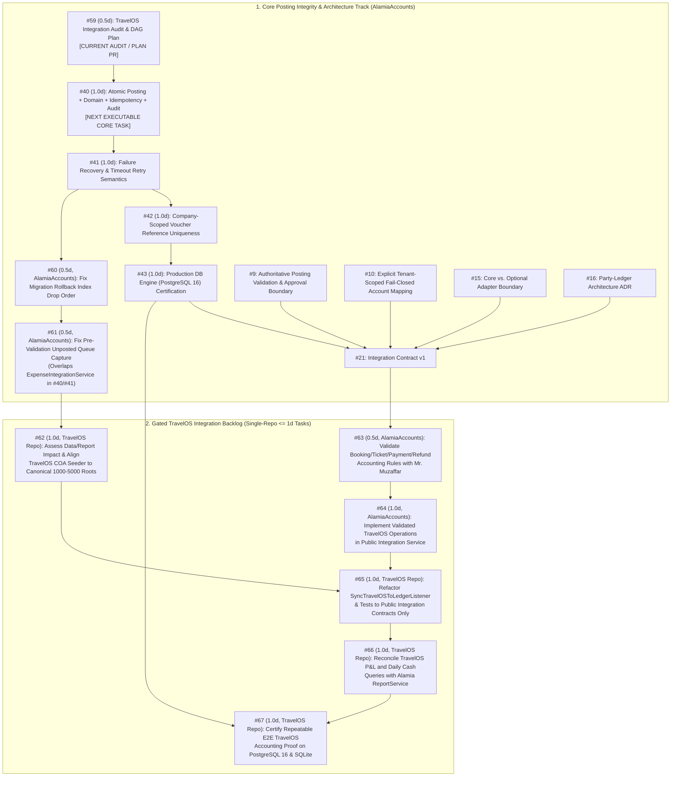

# TravelOS (Kamal Express) → Alamia Accounts Integration Audit & End-to-End Proof Plan

**Status:** Verified Audit & Sequenced Execution Plan (Issue [#59](https://github.com/AlamiaSoft/AlamiaAccounts/issues/59))  
**Date:** 2026-10-22  
**Related Issues:** [#59](https://github.com/AlamiaSoft/AlamiaAccounts/issues/59), [#21](https://github.com/AlamiaSoft/AlamiaAccounts/issues/21), [#18](https://github.com/AlamiaSoft/AlamiaAccounts/issues/18), [#17](https://github.com/AlamiaSoft/AlamiaAccounts/issues/17), [#8](https://github.com/AlamiaSoft/AlamiaAccounts/issues/8) (`#40`–`#43`), [#9](https://github.com/AlamiaSoft/AlamiaAccounts/issues/9), [#10](https://github.com/AlamiaSoft/AlamiaAccounts/issues/10), [#15](https://github.com/AlamiaSoft/AlamiaAccounts/issues/15), [#16](https://github.com/AlamiaSoft/AlamiaAccounts/issues/16)

> [!CAUTION]
> **NON-DEPLOYMENT & DATA PRIVACY MANDATE**
> - This audit and execution plan **does not authorize pilot deployment** to Kamal Express.
> - **Zero live Kamal Express financial or customer data** may be accessed, inspected, or included in fixtures, logs, or tests. All proof fixtures use synthetic, test-owned data in isolated SQLite and PostgreSQL 16 test databases.
> - **Issue [#40](https://github.com/AlamiaSoft/AlamiaAccounts/issues/40)** remains the immediate next core posting-integrity implementation task on the critical path. Dependent TravelOS integration tasks (`#64`–`#67`) must not start ahead of `#40`–`#43` and the applicable `#9`/`#10`/`#15`/`#16`/`#21` gates.

---

## 1. Audited Repositories, Branches, and Commit SHAs

| System Role | Repository | Active Branch | Audited Commit SHA | Verification Status |
| :--- | :--- | :--- | :--- | :--- |
| **Alamia Accounts Core** | `AlamiaSoft/AlamiaAccounts` | `main` (`origin/main`) | `478d71e09ee76698cf59d6f22b9d500534dc7af9` | Clean working tree. [PR #58](https://github.com/AlamiaSoft/AlamiaAccounts/pull/58) merged; [Issue #39](https://github.com/AlamiaSoft/AlamiaAccounts/issues/39) closed. P0 gates (`#3`–`#7`, `#52`, `#54`) and Epic `#8` Days 1–4 (`#36`–`#39`) closed on `main`. |
| **TravelOS Host Application** | `AlamiaSoft/Alamia-SaaS-Platform-Starter` | `travelos-ke-evaluation` (`origin/travelos-ke-evaluation`) | `86ceeb1fe178045d78ba9a66298e822fd55bc195` | Clean working tree. Mounts `alamiasoft/alamia-accounts: @dev` in-process via Composer path repository (`AlamiaAccounts-Backend/packages/AlamiaSoft/alamia-accounts`). |

---

## 2. Evidence-Graded Audit Findings

### 2.1 Code & Architecture Artifacts Inspected

#### A. TravelOS Module (`Alamia-SaaS-Platform-Starter` @ `86ceeb1fe178045d78ba9a66298e822fd55bc195`)
1. **Event Registration & Adapter Listener**:
   - `modules/TravelOS/app/Providers/EventServiceProvider.php` (lines 10–32): Registers `SyncTravelOSToLedgerListener` for four domain events:
     - `Modules\TravelOS\Events\BookingConfirmed` → `handleBookingConfirmed`
     - `Modules\TravelOS\Events\PaymentReceived` → `handlePaymentReceived`
     - `Modules\TravelOS\Events\ExpensePaid` → `handleExpensePaid`
     - `Modules\TravelOS\Events\TicketIssued` → `handleTicketIssued`
   - `modules/TravelOS/src/Listeners/SyncTravelOSToLedgerListener.php` (lines 1–246):
     - Injects `AlamiaSoft\AlamiaAccounts\Services\VoucherService` and `ExpenseIntegrationService`.
     - Imports `Abivia\Ledger\Models\JournalEntry` directly (line 7).
     - `handleBookingConfirmed()` (lines 22–64): Calls `VoucherService::createJournalEntry()` directly with hardcoded accounts `'1200'` (Debit) and `'2200'` (Credit), hardcoded `'currency' => 'PKR'`, and `isLedgerEntryExists('BKG-' . $booking->booking_number)`.
     - `handlePaymentReceived()` (lines 66–108): Calls `VoucherService::createJournalEntry()` directly with hardcoded debit account `($payment->payment_method === 'bank_transfer') ? '1120' : '1110'`, hardcoded credit account `'1200'`, hardcoded `'currency' => 'PKR'`, and `isLedgerEntryExists($payment->payment_number)`.
     - `handleExpensePaid()` (lines 110–133): Delegates to `ExpenseIntegrationService::processExpense()` with `'fail_on_unmapped' => false`.
     - `handleTicketIssued()` (lines 135–202): Calls `VoucherService::createJournalEntry()` directly with hardcoded `'1110'` (Debit for `$sellingPrice`), `'5100'` (Credit for `$commission`), and `'2100'` (Credit for `$cost`).
     - `resolveDomainCode()` (lines 207–233): Queries `DB::table('ledger_domains')` directly and falls back to `'MAIN'` inside `catch (\Throwable) { return 'MAIN'; }`.
     - `isLedgerEntryExists()` (lines 235–245): Queries `DB::table('journal_entries')->where('extra', 'like', '%"reference":"' . $reference . '"%')->exists()` without `domainUuid` scoping.
2. **Operational Event Producers**:
   - `modules/TravelOS/src/Actions/FastSaleCreationAction.php` (lines 18–90) & `TravelOSSalesController::quickStore()` (lines 200–235): Atomically creates a confirmed `Booking` and optional completed `Payment`, dispatching `BookingCreated`, `BookingConfirmed`, and `PaymentReceived`.
   - `modules/TravelOS/src/Http/Controllers/TravelOSSalesController.php` (`confirm()`, lines 284–303): Marks an approved booking confirmed and dispatches `BookingConfirmed`.
   - `modules/TravelOS/src/Http/Controllers/PaymentController.php` (`store()`, lines 84–148): Creates a `Payment` and dispatches `PaymentReceived`.
   - `modules/TravelOS/src/Http/Controllers/AirTicketController.php` (`store()`, lines 68–135): Creates an `AirTicket` and dispatches `TicketIssued` when `status === 'issued'`.
   - `modules/TravelOS/src/Http/Controllers/TravelOSExpenseController.php` (`pay()`, lines 243–254) & `Expense::markAsPaid()` (lines 155–170): Marks an expense paid and dispatches `ExpensePaid`.
3. **Chart of Accounts Seeder**:
   - `modules/TravelOS/database/seeders/TravelAgencyChartOfAccountsSeeder.php` (lines 1–163): Directly calls `Abivia\Ledger\Http\Controllers\LedgerAccountController`, `Abivia\Ledger\Models\LedgerAccount`, `Abivia\Ledger\Root\Rules\Create`, and `DB::table('ledger_domains')->insert(...)`. Seeds `1000 Assets`, `2000 Liabilities`, `3000 Equity`, `4000 Operating Expenses`, and `5000 Revenue`.
4. **Operational Financial Queries**:
   - `modules/TravelOS/src/Http/Controllers/TravelOSFinancialsController.php`, `ProfitLossReportQuery.php`, and `DailyCashRegisterQuery.php`: Compute P&L and daily cash drawer figures directly from `travelos_bookings`, `travelos_payments`, `travelos_expenses`, and `travelos_supplier_invoices` rather than `ReportService`.
5. **Existing TravelOS Architecture & Review Documents Inspected**:
   - `docs/travelos-ke-evaluation/review0.1.md`
   - `.ai/permanent/architecture/03-alamia-accounts-integration-architecture.md`
   - `.ai/permanent/architecture/04-accounting-integration-gap-analysis-and-plan.md`
   - `.ai/transient/handoffs/phase-6.4-accounting-integration-handoff.md`

#### B. Alamia Accounts Core (`AlamiaAccounts` @ `478d71e09ee76698cf59d6f22b9d500534dc7af9`)
- `SalesIntegrationService.php`, `ExpenseIntegrationService.php`, `PostingIdempotencyService.php`, `VoucherService.php`, `CompanyService.php`, `ReportService.php`, and `database/migrations/2026_10_16_000001_create_posting_idempotency_records_and_enforce_unique_constraints.php`.

---

### 2.2 Tests Actually Executed & Recorded Results

Command executed in `F:\Playgrounds\Alamia-SaaS-Platform-Starter`:
```powershell
php artisan test modules/TravelOS/tests/Feature/AlamiaAccountsIntegrationTest.php modules/TravelOS/tests/Feature/ExpenseAccountingIntegrationTest.php modules/TravelOS/tests/Feature/DailySalesAndInvoicingTest.php
```

| Test File | Trait Used | Passed | Failed | Exact Observed Behavior |
| :--- | :--- | :---: | :---: | :--- |
| `modules/TravelOS/tests/Feature/DailySalesAndInvoicingTest.php` | `RefreshDatabase` | **6** | **0** | Passes operational model/Livewire assertions. Does not assert on `domain_journal_entries`; any listener failures are caught and logged by `SyncTravelOSToLedgerListener`. |
| `modules/TravelOS/tests/Feature/AlamiaAccountsIntegrationTest.php` | `DatabaseMigrations` | **0** | **4** | All 4 tests fail during `DatabaseMigrations` rollback teardown on SQLite with `SQLSTATE[HY000]: General error: 1 error in index domain_journal_entries_reference_index after drop column: no such column: reference`. |
| `modules/TravelOS/tests/Feature/ExpenseAccountingIntegrationTest.php` | `DatabaseMigrations` | **0** | **4** | 3 tests fail on the `DatabaseMigrations` SQLite rollback error; 1 test (`it records durable failure in unposted queue when account mapping is invalid`) fails prior to teardown because `InvalidArgumentException('Expense amount must be strictly positive.')` is thrown before reaching the `try/catch` block that writes `UnpostedIntegrationEntry`. |

---

### 2.3 Confirmed Root Causes (Verified by Code + Test Execution)

1. **Confirmed Root Cause 1 — Migration Rollback Index Drop Order on SQLite (`AlamiaAccounts`, tracked in [#60](https://github.com/AlamiaSoft/AlamiaAccounts/issues/60))**:
   - `2024_01_01_000001_create_alamia_extension_tables.php` creates `domain_journal_entries.reference` and index `domain_journal_entries_reference_index`.
   - `2026_10_16_000001_create_posting_idempotency_records_and_enforce_unique_constraints.php` drops `domain_journal_entries_domain_uuid_reference_unique` in `down()` and then calls `$table->dropColumn('reference')` while `domain_journal_entries_reference_index` still exists on `reference`. On SQLite, rebuilding the table during `dropColumn('reference')` fails immediately.
2. **Confirmed Root Cause 2 — Pre-Try Validation Ordering in `ExpenseIntegrationService::processExpense()` (`AlamiaAccounts`, tracked in [#61](https://github.com/AlamiaSoft/AlamiaAccounts/issues/61))**:
   - In `ExpenseIntegrationService::processExpense()` (lines 43–82), payload validation (`amount <= 0`, missing `category_key`) executes before the `try { ... } catch (\Throwable $e)` block (line 84) that records `UnpostedIntegrationEntry` when `fail_on_unmapped = false`.
3. **Confirmed Root Cause 3 — Direct Abivia Kernel Boundary Violations (`Alamia-SaaS-Platform-Starter`, tracked in [#62](https://github.com/AlamiaSoft/AlamiaAccounts/issues/62) & [#65](https://github.com/AlamiaSoft/AlamiaAccounts/issues/65))**:
   - `SyncTravelOSToLedgerListener.php`, `TravelAgencyChartOfAccountsSeeder.php`, `AlamiaAccountsIntegrationTest.php`, and `ExpenseAccountingIntegrationTest.php` directly import `Abivia\Ledger\*` classes and query raw `journal_entries`, `journal_details`, and `ledger_domains` tables in violation of `AGENTS.md` §2.8.
4. **Confirmed Root Cause 4 — Chart of Accounts Root Classification Inversion (`Alamia-SaaS-Platform-Starter`, tracked in [#62](https://github.com/AlamiaSoft/AlamiaAccounts/issues/62))**:
   - `CompanyService::initializeCompany()` and `ReportService` in `AlamiaAccounts` define canonical roots as `1000 = Assets`, `2000 = Liabilities`, `3000 = Revenue`, `4000 = Expenses`, `5000 = Equity`.
   - `TravelAgencyChartOfAccountsSeeder.php` in TravelOS inverts `3000` and `5000`, seeding `3000 = Equity` (`3100 Owner's Capital`, `3200 Retained Earnings`) and `5000 = Revenue` (`5100–5400`).
   - Additionally, `4500 General & Misc` was seeded with `category: false` (postable leaf), which prevents adding child leaf accounts (`4510–4590`) under `4500` unless `4500` is assessed and structured properly.
5. **Confirmed Root Cause 5 — Hardcoded Account Codes, `'MAIN'` Fallback & Bypassed Scoped Idempotency (`Alamia-SaaS-Platform-Starter`, tracked in [#64](https://github.com/AlamiaSoft/AlamiaAccounts/issues/64) & [#65](https://github.com/AlamiaSoft/AlamiaAccounts/issues/65))**:
   - `handleBookingConfirmed()`, `handlePaymentReceived()`, and `handleTicketIssued()` bypass `PostingIdempotencyService`, hardcode account numbers (`1110`, `1120`, `1200`, `2100`, `2200`, `5100`), hardcode `'currency' => 'PKR'`, route `card`/`cheque`/`online` payments to `'1110'` (`Cash in Hand`), check duplicates via an unindexed global `LIKE` query on `journal_entries.extra` without `domainUuid` scoping, fall back to `'MAIN'` on tenant resolution errors, and swallow exceptions in `catch (\Throwable)` with `Log::error()` only.
6. **Confirmed Root Cause 6 — Split Operational vs. Ledger Financial Reporting (`Alamia-SaaS-Platform-Starter`, tracked in [#66](https://github.com/AlamiaSoft/AlamiaAccounts/issues/66))**:
   - `ProfitLossReportQuery` and `DailyCashRegisterQuery` compute financial reports from operational `travelos_*` tables rather than `ReportService`.

---

### 2.4 Hypotheses & Open Business Questions Requiring Reproduction or Validation with Mr. Muzaffar

1. **Multi-Event Double-Counting & Revenue Recognition Semantics (Tracked in [#63](https://github.com/AlamiaSoft/AlamiaAccounts/issues/63))**:
   - *Code Observation*: `SyncTravelOSToLedgerListener` defines `handleBookingConfirmed` (`Dr 1200 / Cr 2200`), `handlePaymentReceived` (`Dr 1110|1120 / Cr 1200`), and `handleTicketIssued` (`Dr 1110 / Cr 5100 / Cr 2100`).
   - *Hypothesis Requiring Reproduction & Stakeholder Validation*: If a single customer counter order triggers `BookingConfirmed` + `PaymentReceived` AND `TicketIssued`, `1110 Cash in Hand` is debited twice and `2200 Unearned Advances` is never cleared. Furthermore, if `TicketIssued` is triggered for a credit booking before payment, `handleTicketIssued` still debits `1110 Cash in Hand`.
   - *Questions to Validate with Mr. Muzaffar (`#63` / `review0.1.md` §2)*:
     1. Does `BookingConfirmed` create an accounting entry (`Dr AR / Cr Unearned Advances`) or only an operational commitment until ticket/invoice issuance?
     2. How should customer advances received before ticket issuance (`Cr 2200`) be distinguished from payments settling an invoiced receivable (`Cr 1200`)?
     3. Should `TicketIssued` recognize **Net Agency Commission** (`Cr Airline Payable [cost]` + `Cr Ticket Commission Revenue [margin]`) or **Gross Principal Revenue** (`Cr Gross Ticket Sales [selling_price]` + `Dr Direct Ticket Cost [cost] / Cr Airline Payable [cost]`), and how are taxes/fees separated?
     4. What are the exact reversal/refund rules when a ticket or booking is cancelled or reissued?
2. **Existing Seeded/Evaluation Data Impact (Tracked in [#62](https://github.com/AlamiaSoft/AlamiaAccounts/issues/62))**:
   - `.ai/transient/handoffs/phase-6.4-accounting-integration-handoff.md` notes 17 synced transactions in local evaluation domain `ACME`. Before altering `TravelAgencyChartOfAccountsSeeder` roots (`3000`/`5000`) or `4500`, existing local evaluation data and report expectations must be inspected in `#62`.

---

## 3. Contract Comparison Against Issue #21 & Gap Classification

| Gap ID | Contract Dimension (#21) | Current TravelOS State (`86ceeb1`) | Classification | Tracking Issue |
| :--- | :--- | :--- | :---: | :--- |
| **G-01** | Clean migration lifecycle & durable unposted validation capture | `2026_10_16_000001` `down()` fails on SQLite index drop; `ExpenseIntegrationService` throws pre-validation error before writing `UnpostedIntegrationEntry`. | **Blocker** | [#60](https://github.com/AlamiaSoft/AlamiaAccounts/issues/60), [#61](https://github.com/AlamiaSoft/AlamiaAccounts/issues/61) |
| **G-02** | Abivia Kernel Encapsulation (`AGENTS.md` §2.8) | Direct `Abivia\Ledger` imports and raw `journal_entries`/`ledger_domains` queries in listener, seeder, and tests. | **Blocker** | [#62](https://github.com/AlamiaSoft/AlamiaAccounts/issues/62), [#65](https://github.com/AlamiaSoft/AlamiaAccounts/issues/65) |
| **G-03** | Canonical COA Hierarchy (`1000`–`5000`) | `TravelAgencyChartOfAccountsSeeder` inverts `3000` (Equity) and `5000` (Revenue), conflicting with `CompanyService` and `ReportService`. | **Blocker** | [#62](https://github.com/AlamiaSoft/AlamiaAccounts/issues/62) |
| **G-04** | Validated Double-Entry Event Lifecycle | Unvalidated `BookingConfirmed` / `PaymentReceived` / `TicketIssued` interaction risks double-debiting Cash (`1110`) and stranding Unearned Advances (`2200`). | **Blocker** | [#63](https://github.com/AlamiaSoft/AlamiaAccounts/issues/63), [#64](https://github.com/AlamiaSoft/AlamiaAccounts/issues/64) |
| **G-05** | Scoped Durable Idempotency (`#8`) | Bookings, payments, and tickets bypass `PostingIdempotencyService` and use an unindexed global `LIKE` query on `journal_entries.extra`. | **Blocker** | [#40](https://github.com/AlamiaSoft/AlamiaAccounts/issues/40)–[#43](https://github.com/AlamiaSoft/AlamiaAccounts/issues/43), [#64](https://github.com/AlamiaSoft/AlamiaAccounts/issues/64), [#65](https://github.com/AlamiaSoft/AlamiaAccounts/issues/65) |
| **G-06** | Trusted Tenant Context & Failure Visibility (`#5`, `#40`, `#41`) | `resolveDomainCode()` silently falls back to `'MAIN'` on error; listener swallows exceptions via `Log::error()` without `UnpostedIntegrationEntry`. | **Blocker** | [#64](https://github.com/AlamiaSoft/AlamiaAccounts/issues/64), [#65](https://github.com/AlamiaSoft/AlamiaAccounts/issues/65) |
| **G-07** | Tenant-Scoped Fail-Closed Account Mapping (`#10`) | Hardcodes `'1110'`, `'1120'`, `'1200'`, `'2100'`, `'2200'`, `'5100'` and routes `card`/`cheque`/`online` payments to `'1110'`. | **Blocker** | [#10](https://github.com/AlamiaSoft/AlamiaAccounts/issues/10), [#64](https://github.com/AlamiaSoft/AlamiaAccounts/issues/64), [#65](https://github.com/AlamiaSoft/AlamiaAccounts/issues/65) |
| **G-08** | Single Financial Reporting Truth | `ProfitLossReportQuery` and `DailyCashRegisterQuery` query operational `travelos_*` tables instead of `ReportService`. | **Required Before Pilot** | [#66](https://github.com/AlamiaSoft/AlamiaAccounts/issues/66) |
| **G-09** | Refunds, Ticket Voids/Reissues, Supplier Settlements & FX | Reversal (`REV-`) workflows for voided/refunded tickets and supplier invoice disbursements are not yet wired. | **Deferred (Wave 2)** | Post-[#67](https://github.com/AlamiaSoft/AlamiaAccounts/issues/67) |

---

## 4. Provisional First Vertical Slice & Realistic End-to-End Proof Fixture

> [!WARNING]
> **PROVISIONAL ACCOUNTING ENTRIES — PENDING VALIDATION WITH MR. MUZAFFAR ([#63](https://github.com/AlamiaSoft/AlamiaAccounts/issues/63))**
> The candidate postings below illustrate a balanced, non-duplicating lifecycle for the first vertical slice using canonical Alamia Accounts COA roots (`1000 Assets`, `2000 Liabilities`, `3000 Revenue`, `4000 Expenses`, `5000 Equity`) and realistic opening balances. The exact event triggers and gross-vs-net revenue recognition rules **must be validated with Mr. Muzaffar in [#63](https://github.com/AlamiaSoft/AlamiaAccounts/issues/63)** before coding [#64](https://github.com/AlamiaSoft/AlamiaAccounts/issues/64).

### 4.1 Realistic Compound Opening Balance (`OB-2026-001`) & Transaction Progression

All accounts are resolved via explicit tenant configuration (never hardcoded in application logic):
- `1110` — Cash in Hand (Asset, leaf)
- `1120` — Primary Bank Operating Account (Asset, leaf)
- `1200` — Customer Receivables / AR (Asset, leaf)
- `2100` — Airline / GDS Payables / AP (Liability, leaf)
- `2200` — Unearned Customer Advances (Liability, leaf)
- `3100` — Air Ticket Sales / Commission Revenue (Revenue, leaf under `3000 Revenue`)
- `4520` — Meals, Refreshments & Office Expenses (Expense, leaf under `4000 Expenses`)
- `5100` — Owner's Capital (Equity, leaf under `5000 Equity`)

| Step | Business Action | Scoped Idempotency Tuple `(domain, source, id, op, v1)` | Provisional Double-Entry Posting | Running Cash (`1110`) | Running Bank (`1120`) | Running AR (`1200`) |
| :--- | :--- | :--- | :--- | :---: | :---: | :---: |
| **0. Opening Balance** | `POST /api/opening-balances` (`OB-2026-001`) | Compound OB Batch Guard | **Dr** `1110 Cash`: `100,000.00`<br>**Dr** `1120 Bank`: `500,000.00`<br>**Cr** `5100 Capital`: `600,000.00` | `Dr 100,000.00` | `Dr 500,000.00` | `0.00` |
| **1. Booking Confirmed** *(Provisional)* | `BookingConfirmed` (`bkg_1001`, `PKR 155,000`) | `(domain, 'travelos', 'booking:1001', 'booking_confirmed', 'v1')` | **Dr** `1200 AR`: `155,000.00`<br>**Cr** `2200 Unearned Advances`: `155,000.00` | `Dr 100,000.00` | `Dr 500,000.00` | `Dr 155,000.00` |
| **2. Ticket Issued** *(Provisional)* | `TicketIssued` (`tkt_2001`, Fare `155,000`, Cost `140,000`, Margin `15,000`) | `(domain, 'travelos', 'ticket:2001', 'ticket_issued', 'v1')` | **Dr** `2200 Unearned Advances`: `155,000.00`<br>**Cr** `2100 Airline Payables`: `140,000.00`<br>**Cr** `3100 Ticket Revenue`: `15,000.00` | `Dr 100,000.00` | `Dr 500,000.00` | `Dr 155,000.00` |
| **3. Payment Received** *(Provisional)* | `PaymentReceived` (`pay_3001`, `PKR 155,000` via `bank_transfer`) | `(domain, 'travelos', 'payment:3001', 'payment_received', 'v1')` | **Dr** `1120 Bank`: `155,000.00`<br>**Cr** `1200 AR`: `155,000.00` | `Dr 100,000.00` | `Dr 655,000.00` | `0.00` |
| **4. Expense Paid** | `ExpensePaid` (`exp_4001`, `PKR 5,000` via `cash`) | `(domain, 'travelos', 'expense:4001', 'expense_paid', 'v1')` | **Dr** `4520 Office Expenses`: `5,000.00`<br>**Cr** `1110 Cash`: `5,000.00` | `Dr 95,000.00` | `Dr 655,000.00` | `0.00` |

### 4.2 Expected Financial Statement Reconciliation After Step 4
- **Trial Balance (`ReportService::getTrialBalance`)**:
  - `1110 Cash in Hand`: **Dr `95,000.00`** (positive, realistic cash balance after `100,000.00` opening balance and `5,000.00` cash expense)
  - `1120 Bank Operating Account`: **Dr `655,000.00`** (`500,000.00` opening balance + `155,000.00` customer bank transfer)
  - `1200 Customer Receivables`: **`0.00`** (`Dr 155,000.00` / `Cr 155,000.00`)
  - `2100 Airline Payables`: **Cr `140,000.00`**
  - `2200 Unearned Advances`: **`0.00`** (`Cr 155,000.00` / `Dr 155,000.00`)
  - `5100 Owner's Capital`: **Cr `600,000.00`**
  - `3100 Air Ticket Revenue`: **Cr `15,000.00`**
  - `4520 Office Expenses`: **Dr `5,000.00`**
  - **Invariant**: `Total Debits (755,000.00) === Total Credits (755,000.00)`
- **Profit & Loss (`ReportService::getProfitAndLoss`)**:
  - Total Revenue (`3000`): `15,000.00`
  - Total Expenses (`4000`): `5,000.00`
  - **Net Profit**: **`10,000.00`**
- **Balance Sheet (`ReportService::getBalanceSheet`)**:
  - Total Assets (`95,000.00 + 655,000.00`): **`750,000.00`**
  - Total Liabilities (`140,000.00`) + Total Equity (`600,000.00 Capital + 10,000.00 Net Profit = 610,000.00`): **`750,000.00`**

---

## 5. Dependency-Ordered One-Day Task DAG & Scheduling Review

All follow-up work is decomposed into **single-repository**, **`≤ 1 working day`** issues (`#60`–`#67`) and sequenced behind the canonical core gates (`#40`–`#43`, `#9`, `#10`, `#15`, `#16`, `#21`) in [#18](https://github.com/AlamiaSoft/AlamiaAccounts/issues/18).

### 5.1 Scheduling Analysis of `#60` and `#61` Relative to Core Sequence `#40`–`#43`
- **Next Active Core Task:** **[#40](https://github.com/AlamiaSoft/AlamiaAccounts/issues/40)** (`[Task][Day 5][#8] Make posting identity, journal association and audit commit atomically`) is the immediate next executable implementation task on `main`.
- **Why `#61` Is Gated Behind `#40` and `#41`:** [#61](https://github.com/AlamiaSoft/AlamiaAccounts/issues/61) modifies `ExpenseIntegrationService::processExpense()` validation and `UnpostedIntegrationEntry` failure recording. That exact method and error-handling boundary are the subject of `#40` (transaction boundary) and [#41](https://github.com/AlamiaSoft/AlamiaAccounts/issues/41) (failure recovery and timeout retry). Scheduling `#61` before `#40` and `#41` would cause merge conflicts and duplicate refactoring in `ExpenseIntegrationService`. Therefore, `#61` is strictly blocked until `#40` and `#41` are merged.
- **Why `#60` Is Sequenced After `#41`/`#43`:** [#60](https://github.com/AlamiaSoft/AlamiaAccounts/issues/60) only touches the `down()` method of migration `2026_10_16_000001_create_posting_idempotency_records_and_enforce_unique_constraints.php` and has no runtime conflict with `#40` or `#41`. However, to avoid interrupting the active core posting-integrity sequence (`#40` → `#41` → `#42` → `#43`), `#60` and `#61` are scheduled after `#41` (or immediately after `#43` if keeping Epic `#8` unbroken).



### Linked Child Issues Created for #59

| Issue | Title | Target Repository | Effort | Hard Dependencies | Required Verification Gate |
| :--- | :--- | :--- | :---: | :--- | :--- |
| **[#60](https://github.com/AlamiaSoft/AlamiaAccounts/issues/60)** | `[Task][#59][Day 1a] Fix domain_journal_entries_reference_index drop order on migration rollback` | `AlamiaAccounts` | `0.5d` | `#59`, scheduled after `#41`/`#43` so `#40`–`#43` is undisrupted | PHPUnit migration `migrate` → `migrate:rollback` → `migrate` regression test passing on SQLite & PostgreSQL 16. |
| **[#61](https://github.com/AlamiaSoft/AlamiaAccounts/issues/61)** | `[Task][#59][Day 1b] Record UnpostedIntegrationEntry on pre-validation failure when fail_on_unmapped is false` | `AlamiaAccounts` | `0.5d` | `#40`, `#41`, `#60` (overlaps `ExpenseIntegrationService` failure recovery in `#40`/`#41`) | PHPUnit regression test verifying `amount <= 0` / invalid mapping with `fail_on_unmapped = false` persists `UnpostedIntegrationEntry`. |
| **[#62](https://github.com/AlamiaSoft/AlamiaAccounts/issues/62)** | `[Task][#59][Day 2] Assess TravelOS COA data impact and align seeder to canonical 1000-5000 roots via CompanyService/AccountService` | `Alamia-SaaS-Platform-Starter` | `1.0d` | `#60`, `#61` | Written data/report impact assessment + zero `Abivia\Ledger` imports in seeder + `ReportService` root classification test on SQLite & PostgreSQL 16. |
| **[#63](https://github.com/AlamiaSoft/AlamiaAccounts/issues/63)** | `[Task][#59][Day 3] Validate TravelOS booking, ticket, payment, and refund accounting rules with Mr. Muzaffar` | `AlamiaAccounts` | `0.5d` | `#16`, `#21` | Stakeholder sign-off recorded resolving all open questions in `review0.1.md` §2. |
| **[#64](https://github.com/AlamiaSoft/AlamiaAccounts/issues/64)** | `[Task][#59][Day 4] Implement validated TravelOS operations in Alamia public integration service with fail-closed mapping` | `AlamiaAccounts` | `1.0d` | `#40`–`#43`, `#9`, `#10`, `#15`, `#16`, `#21`, `#61`, `#63` | PHPUnit feature suite on SQLite & PostgreSQL 16 + `node scripts/verify-architecture.js` green. |
| **[#65](https://github.com/AlamiaSoft/AlamiaAccounts/issues/65)** | `[Task][#59][Day 5] Refactor SyncTravelOSToLedgerListener and TravelOS integration tests to use Alamia public contracts only` | `Alamia-SaaS-Platform-Starter` | `1.0d` | `#62`, `#64` | `AlamiaAccountsIntegrationTest` & `ExpenseAccountingIntegrationTest` green on SQLite & PostgreSQL 16 with zero `Abivia\Ledger` references. |
| **[#66](https://github.com/AlamiaSoft/AlamiaAccounts/issues/66)** | `[Task][#59][Day 6] Reconcile TravelOS Profit & Loss and Daily Cash Register queries with Alamia ReportService` | `Alamia-SaaS-Platform-Starter` | `1.0d` | `#65` | Automated feature test proving TravelOS P&L and Daily Cash match `ReportService` outputs. |
| **[#67](https://github.com/AlamiaSoft/AlamiaAccounts/issues/67)** | `[Task][#59][Day 7] Execute and certify repeatable end-to-end TravelOS accounting proof on PostgreSQL 16 and SQLite` | `Alamia-SaaS-Platform-Starter` | `1.0d` | `#43`, `#63`–`#66` | Full E2E proof suite green on PostgreSQL 16 & SQLite with realistic opening balances, replay, conflict, unmapped queue, and cross-tenant isolation. |

---

## 6. End-to-End Acceptance Criteria & Pilot Release Gates

### 6.1 Acceptance Criteria for the Repeatable End-to-End Proof ([#67](https://github.com/AlamiaSoft/AlamiaAccounts/issues/67))
1. **Production Database Parity**: Executed and verified on **PostgreSQL 16** (as well as SQLite for fast feedback).
2. **Realistic Opening Balance Foundation**: Test tenant initialized via `CompanyService::initializeCompany()` with a balanced compound Opening Balance (`OB-YYYY-001`) establishing realistic positive Cash (`1110`) and Bank (`1120`) balances before operational events run.
3. **Source-to-Ledger Traceability**: Every posted operational event produces exactly one balanced journal voucher linked to a `PostingIdempotencyRecord` (`status = 'completed'`, deterministic `payload_hash`) and an `AccountingAuditTrail` record.
4. **Idempotency & Conflict Safety**:
   - Re-dispatching identical events returns the original voucher (`replayed = true`) with zero additional journal entries.
   - Re-dispatching the same `(source_id, operation)` with a modified amount fails closed with `IdempotencyConflictException`.
5. **Fail-Closed Mapping & Unposted Queue**:
   - Missing or category (`category = true`) account mappings fail closed when `fail_on_unmapped = true` and persist an actionable `UnpostedIntegrationEntry` when `fail_on_unmapped = false`.
6. **Cross-Tenant Isolation**: A second tenant provisioned in the same database sees zero vouchers, idempotency records, unposted entries, or report balances from the primary tenant.
7. **Financial Statement & Dashboard Reconciliation**: `ReportService::getTrialBalance()`, `getProfitAndLoss()`, `getBalanceSheet()`, and `TravelOSFinancialsController` report identical, balanced totals (`Dr === Cr` and `Assets === Liabilities + Equity`).

### 6.2 Explicit Pilot Release Gates (Required Before Any Kamal Express Pilot Access)
Pilot readiness under [#17](https://github.com/AlamiaSoft/AlamiaAccounts/issues/17) **cannot** be claimed until every gate below is closed with linked evidence:
- [ ] Core posting-integrity sequence [#40](https://github.com/AlamiaSoft/AlamiaAccounts/issues/40), [#41](https://github.com/AlamiaSoft/AlamiaAccounts/issues/41), [#42](https://github.com/AlamiaSoft/AlamiaAccounts/issues/42), and [#43](https://github.com/AlamiaSoft/AlamiaAccounts/issues/43) merged and green on PostgreSQL 16 CI.
- [ ] Core architecture gates [#9](https://github.com/AlamiaSoft/AlamiaAccounts/issues/9), [#10](https://github.com/AlamiaSoft/AlamiaAccounts/issues/10), [#15](https://github.com/AlamiaSoft/AlamiaAccounts/issues/15), [#16](https://github.com/AlamiaSoft/AlamiaAccounts/issues/16), and [#21](https://github.com/AlamiaSoft/AlamiaAccounts/issues/21) merged on `main`.
- [ ] Mr. Muzaffar's accounting validation sign-off completed in [#63](https://github.com/AlamiaSoft/AlamiaAccounts/issues/63).
- [ ] All integration tasks [#60](https://github.com/AlamiaSoft/AlamiaAccounts/issues/60)–[#67](https://github.com/AlamiaSoft/AlamiaAccounts/issues/67) merged and verified on PostgreSQL 16 and SQLite.
- [ ] Internal UAT, security review, and backup/restore verification completed per [#17](https://github.com/AlamiaSoft/AlamiaAccounts/issues/17).
